# LLM 学习笔记（二）：从模型架构到训练与推理

在[上一份笔记](from-token-to-transformer.md)，我们了解了 Attention 机制和 Transformer Block 的基本结构。事实上，Attention 机制只解决了模型要如何理解输入，却没有规范模型要如何输出。在这份笔记中，我们会进一步讨论 Encoder-Decoder、SFT、RLHF、ICL，尝试理解模型为什么会这样回复，以及在回复前模型被训练了什么。

## Encoder-Decoder

在上一篇笔记中，我们介绍了单个 Transformer Block 的结构，而一个 Transformer 是由多个 Transformer Block 堆叠而成的。最初的 Transformer 结构其实包含 Encoder 和 Decoder，如下：

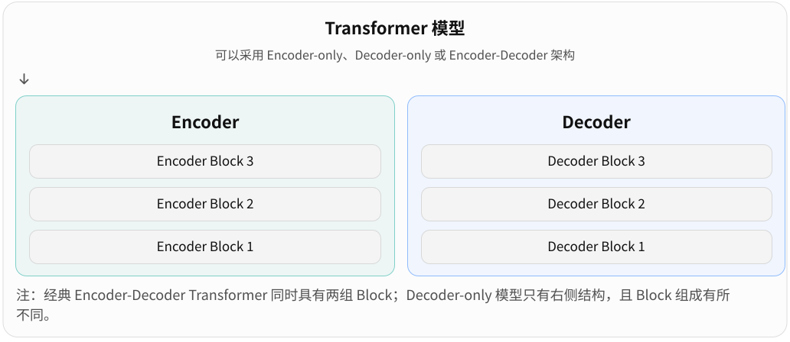{ width="75%" }

Encoder 和 Decoder 分别由多个 Transformer Block 堆叠而成（对应 Encoder Block, Decoder Block）,它们都是神经网络模块，结构也比较相似。那么一个问题是：**如果 Encoder 和 Decoder 都使用 Transformer Block，为什么还要把它们分成两种？**其关键在于它们允许信息怎么流动，以及如何利用这些信息。

实际上，Transformer 并不一定需要同时包含这两部分，随着技术的发展，出现了三种主要架构：

| 架构            | 代表模型 | 主要特点                        |
| --------------- | -------- | ------------------------------- |
| Encoder-only    | BERT     | 擅长理解、分类、特征提取        |
| Decoder-only    | GPT      | 根据已有 Token 逐步生成新 Token |
| Encoder-Decoder | T5       | 编码输入，再根据输入生成输出    |

现有的绝大多数大语言模型，都采用 Decoder-only 结构，如下：

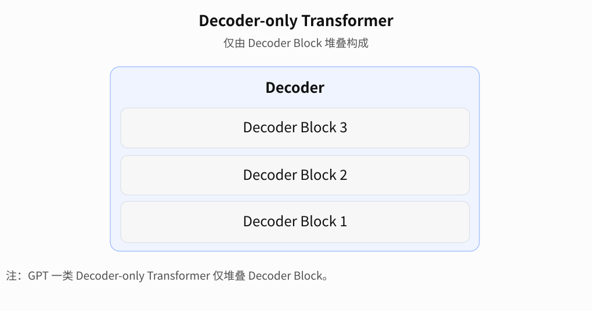{ width="75%" }

最初的 Encoder-Decoder 将输入输出分开，也即将理解和输出分开。

### Encoder

我们已经学习过 Self-Attention，因此理解 Encoder 并不难。考虑这个示例：

> I love apples

假设对应三个 Token：

> `I` `love` `apples`

Encoder 首先将它们转换成向量，加入位置信息，然后通过多层 Transformer Block 处理。

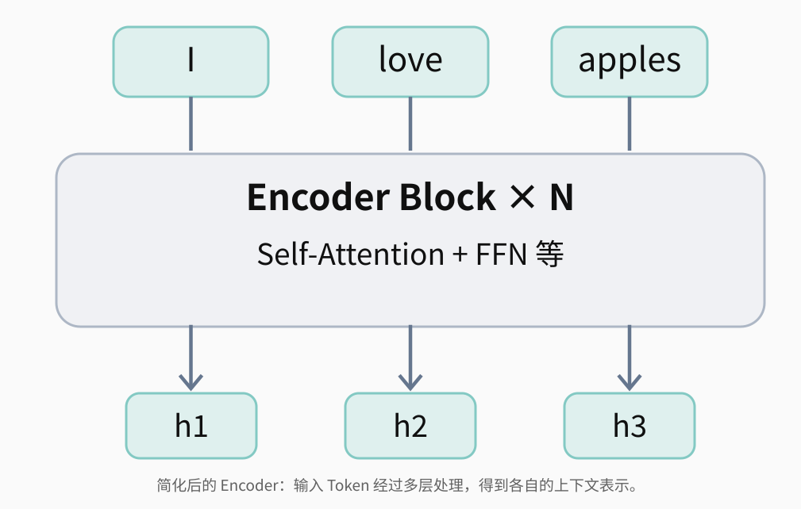{ width="75%" }

注意，经典 Encoder 的 Self-Attention 通常是双向的，这意味着处理 `I` 时，它可以关注 `love` 和 `apples`；处理 `apples` 时，它也可以关注 `I` 和 `love`。这是一个很自然的想法，因为我们希望模型理解输入，那么就希望充分利用每个位置的信息。

Encoder 不需要预测下一个词，它的任务是加工已经提供的输入。因此，在常规的双向 Encoder 中，各个 Token 可以互相关注，不需要因果掩码。

经过多个 Block 后，每个 Token 得到一个新的向量表示，这些向量不再只包含原始词的信息，还融入了上下文表示。

到这里，你会发现 Encoder 机制和前面我们学习的 Attention / Transformer Block 大体一致。Encoder 的主要职责是处理输入。

### Decoder

假设 Encoder 已经处理好了英文句子，下面需要将它翻译成中文。

> I love apples ➡ 我喜欢苹果

Decoder 需要遵循我们之前学习过的因果注意力，其目标是逐步输出：

> 我 ➡ 喜欢 ➡ 苹果

为输出相应的翻译，Decoder 需要知道输入是什么。也就是说，Decoder 需要一个机制来利用之前 Encoder 处理过的信息。**Cross-Attention** 是一个重要机制。

#### Cross-Attention

Cross-Attention 并不是一套陌生的机制，回顾之前的 Attention 机制：从一段 Token 序列中投影出 Q、K、V 三组向量。

Cross-Attention 只是来源不同，Q 和 K/V 不再来自同一组序列表示：

- Q 来自 Decoder 当前的隐藏状态

- K、V 来自 Encoder 的输出

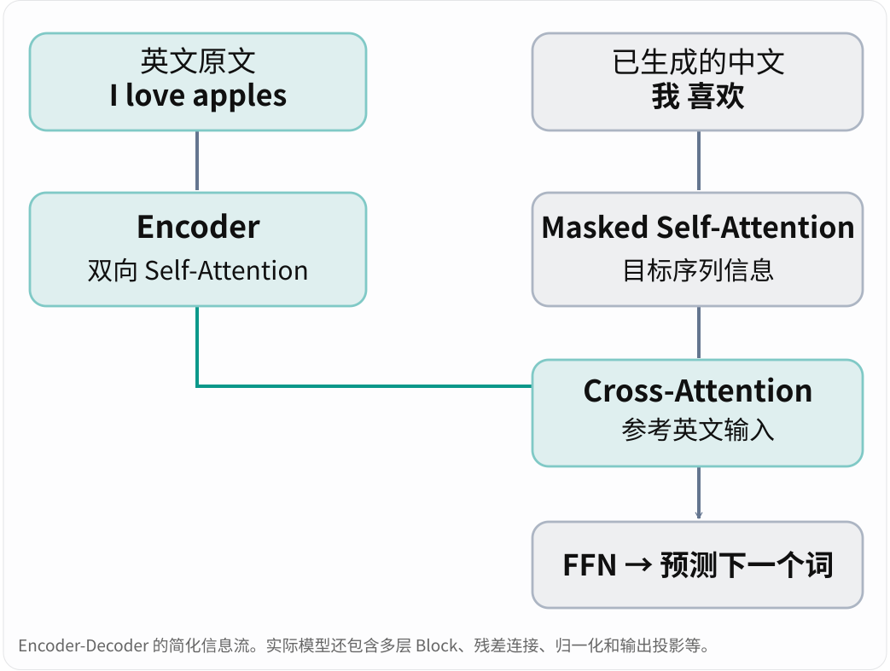{ width="75%" }

我们用公式具体看看 Cross-Attention 如何计算。假设：

- $H_{\text{dec}}$：Decoder 经过 Masked Self-Attention 等处理后，送入 Cross-Attention 的隐藏状态。

- $H_{\text{enc}}$：Encoder 输出的隐藏状态。

那么：

$$
\begin{aligned}
Q &= H_{\text{dec}}W_Q \\
K &= H_{\text{enc}}W_K \\
V &= H_{\text{enc}}W_V
\end{aligned}
$$

放入 Attention 公式：

$$
\operatorname{Attention}(Q, K, V) = \operatorname{softmax}\left(\frac{QK^T}{\sqrt{d_k}}\right)V
$$

可以看到，Cross-Attention 在数学上并没有引入一套全新的运算，它和 Self-Attention 的关键区别就是 Q 和 K/V 的来源。通过这种处理，Decoder 可以在处理目标序列的同时，参考整个英文输入。

一个疑问：**Decoder 最开始的序列是空，Q 从哪里而来？第一个 Token 是怎么产生的？**

在学习 Attention 机制时，我们知道：

$$
Q = XW_Q
$$

问题在于如果 Decoder 没有任何输入，那么显然也没法计算 Q。注意公式 $Q = H_{\text{dec}}W_Q$ 里的 $H_{\text{dec}}$，它是一个隐藏状态。在经典的自回归 Encoder-Decoder 模型中，我们可以为 Decoder 提供一个特殊的起始 Token，例如 `<BOS>`（Beginning of Sequence）。这个 `<BOS>` 可以作为最初的 $H_{\text{dec}}$。

于是在第一次生成的时候，我们利用 `<BOS>` 计算 Q，Decoder 利用起始 Token 建立查询状态，通过 Cross-Attention 参考英文输入，然后预测第一个中文 Token。后续生成时，Decoder 就能利用之前已经生成的 Token，构建新的查询状态。

#### 如何配合 Encoder

Decoder 有一个关键的问题：它要如何理解 Encoder 的输出？Cross-Attention 让 Decoder 可以参考 Encoder 处理好的信息，但前提是 Decoder 能够理解。

例如，假设 Encoder 输出：

$$
H_{\text{enc}} =
\begin{bmatrix}
h_1 \\
h_2 \\
h_3
\end{bmatrix}
$$

它们分别对应 `I`、`love`、`apples` 的上下文表示。直接送入 Decoder，它未必能够理解，对翻译也未必会有帮助。实际上，Encoder-Decoder 需要通过训练学会相互配合。

一个简化的训练过程可能如下：

- 最初，Encoder 输出的向量未必有利于 Decoder 完成翻译，Decoder 的 Cross-Attention 也未必知道该关注哪里。

  - 模型的预测可能是错的

- 训练过程中，我们可以计算预测结果与目标结果的损失，并通过反向传播调整模型参数。

- 随着训练进行，Encoder 逐渐学会产生对翻译有用的表示，Decoder 也逐渐学会利用这些表示生成目标语言。

我们能调节的参数包括：

- Encoder 中的 Attention、FFN 等参数。

- Decoder 中的 Attention、FFN 等参数。

- Cross-Attention 中的 Q、K、V 投影参数。

看到了吗？这里不是 Decoder 天生能够理解 Encoder 的输出，而是两者通过端到端训练，逐渐形成了相互适配的表示和计算方式。

#### 输出投影

前面我们一直在讲 Decoder 如何处理和利用已有信息，却还没有介绍它最终如何输出文字。那么，具体过程是怎样的？

我们知道，Tokenizer 将输入切分为 Token。每一个 Tokenizer 都会根据其背后的词表进行切分。输出则像是切分的逆过程，根据词表计算分数选择 Token，再转化为文字。

假设词表有 50,000 个 Token，我们需要让模型为词表中的每个 Token 计算一个分数。为此，模型会使用一个输出投影矩阵（通常称为 LM Head）：

$$
\text{logits} = h_tW_{\text{vocab}} + b
$$

假设隐藏状态的维度是 768，词表大小为 50,000，那么：

$$
(1, 768) \times (768, 50000) = (1, 50000)
$$

于是，我们就得到了 50,000 个分数，每个分数对应词表中的一个 Token。这些分数称为 logits。随后，我们可以通过 Softmax 得到概率分布：

$$
P = \operatorname{softmax}(\text{logits})
$$

接下来，模型需要选择下一个 Token。例如，可以采用贪心解码（Greedy Decoding），每次选择概率最高的 Token；也可以依据概率分布采样。Temperature、Top-p 等参数影响的就是这个选择过程。

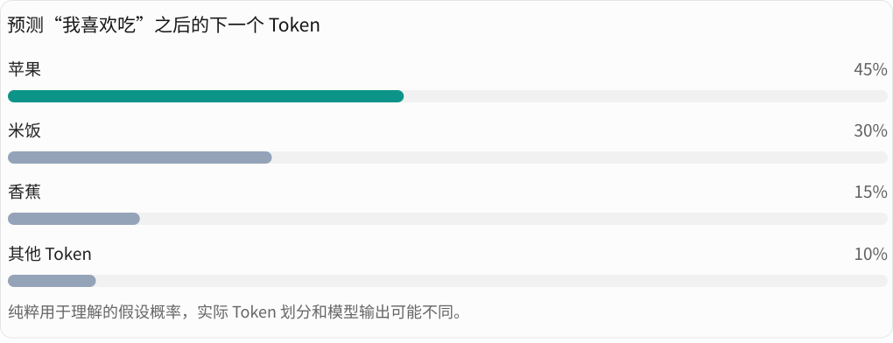{ width="75%" }

假设最终选中了“苹果”对应的 Token ID，那么 Tokenizer 就会根据 Token ID，按照对应的词表和解码规则，将 Token 序列还原成文本。

注意，选中的 Token ID 还会转换成 Embedding，成为后续生成的输入之一，继续预测下一个 Token，直到生成结束标记，或者达到其他停止条件。

总结一下整个流程：**输入已有 Token → Transformer 计算 → 得到概率分布 → 选择 Token → 加入上下文 → 再次计算**。

## Decoder-only

Transformer 最初采用 Encoder-Decoder 架构，将输入的处理与输出的生成分别交给 Encoder 和 Decoder。随着大语言模型的发展，Decoder-only 逐渐成为主流架构，GPT、Llama 等模型都采用了这种结构。

Decoder-only 不再使用独立的 Encoder，而是通过多层 Decoder Block 同时完成输入信息的处理和文本生成。它将用户的问题与模型生成的回答组织在同一个 Token 序列中，通过因果注意力利用前面的上下文信息，不断预测并生成下一个 Token。

例如，用户输入“请将 I love apples 翻译成中文”，模型会先处理整个 Prompt，再逐步预测出“我喜欢苹果”。每次生成的新 Token 都会加入上下文，成为后续预测的依据。

处理过程可能是这样的：

> [user] I love apples 翻译成中文
>
> ⬇（Decoder 处理，然后预测...）
>
> [user] I love apples 翻译成中文 [assistant] ...

由此可见，Decoder-only 并不意味着模型只负责输出，而是通过同一套神经网络处理输入，并在已有上下文的基础上逐步生成回答。

## 训练

### 预训练（Pre-training）

#### 从未训练的模型开始

假设我们创建了一个 Transformer 模型，它拥有完整结构，包括 Attention、FFN、LM Head 等，但是参数尚未经过有效训练。

下面进行训练，假设我们给它一句话：

> 我喜欢吃苹果。

假设 Tokenizer 根据词表将这句话拆分为：

- 我

- 喜欢

- 吃

- 苹果

- 。

我们希望模型根据前面的 Token 学会预测后面的 Token，也就是：

| 已有上下文      | 正确的下一个 Token |
| --------------- | ------------------ |
| 我              | 喜欢               |
| 我 喜欢         | 吃                 |
| 我 喜欢 吃      | 苹果               |
| 我 喜欢 吃 苹果 | 。                 |

我们不需要人工为这些样本标注答案，因为训练文本本身就提供了正确的下一个 Token。这就是自监督学习（Self-supervised Learning）的典型例子。这个特性也使大规模训练成为可能，模型可以“吃”掉互联网中海量的数据。

#### 模型如果预测错了，怎么调整？

假设模型输入了：`我 喜欢 吃`

我们期望正确答案：`苹果`，而模型预测：

- 米饭：50%

- 香蕉：30%

- **苹果**：10%

- 其它：10%

模型认为“米饭”概率最高，但正确答案是“苹果”。

如何衡量这次预测的效果？如果预测错了如何调整？

##### Loss

Loss 是机器学习中的常见概念。语言模型通常使用交叉熵损失（Cross-Entropy Loss），单个 Token 位置的 Loss 可以简化为：

$$
L = -\log P(\text{正确 Token})
$$

其中 $P(\text{正确 Token})$ 是模型分配给正确 Token 的概率，这意味着：

- 如果模型认为**正确答案**的概率很**高**，Loss 就比较**小**。

- 如果模型认为**正确答案**的概率很**低**，Loss 就比较**大**。

对于一句完整的文本，我们可以同时计算多个位置的 Loss，再将它们汇总，例如取平均。这样就得到了模型在这段文本上的训练损失。

模型在训练中，会根据 Loss 调整参数。另外，模型即便恰好选中了正确的 Token，也不意味着训练目标已经达到。训练时，正确的 Token 会被期望分配更高的概率。

##### 根据 Loss 修改模型

我们知道模型预测错了，也计算出了 Loss，具体要如何修改模型参数？

一个 Transformer 可能拥有数十亿甚至更多参数，这些参数可能分散在：

- Embedding

- Attention 的 Q、K、V 投影

- FFN

- 归一化相关参数

- LM Head

如何修改，才能降低 Loss？如果你关注过一些科普视频，相信你一定听过反向传播和梯度下降。

反向传播是在计算 Loss 对各参数的梯度，我们根据计算结果，沿着梯度的反方向调整参数，以降低 Loss。

一个简单的梯度下降公式是：

$$
\theta_{\text{new}} = \theta_{\text{old}} - \eta\nabla_\theta L
$$

其中：

- $\theta$ 代表模型参数。

- $\nabla_\theta L$ 代表 Loss 对参数的梯度。

- $\eta$ 是学习率。

实际训练通常使用 AdamW 等优化器，但核心思想类似：利用梯度信息调整参数，以降低损失。注意，梯度可以沿计算图反向传播。这意味着（如果）模型没有正确预测“苹果”，也并不只是更新 LM Head 中“苹果”对应的参数，Attention、FFN、Embedding 等可训练参数也会受到影响。

#### 为什么预测能够产生智能

目前，我们给模型的训练目标非常简单：根据已有上下文，提高正确的下一个 Token 的预测概率。

这个目标在一句话中相对简单，但在大量复杂文本上完成这个任务并不简单。

例如：

> 小明把杯子放在桌子边缘，不小心碰了一下，杯子掉到地上，发出了……

为了正确预测后续文本，模型如果能够掌握一些关于物体、动作、因果关系的规律，就有可能表现得更好。

再如：

> 小明有三个苹果，送给小红一个，现在还剩……

模型如果学到了某种数量关系或计算方法，也可能比仅仅记忆固定句子更容易处理不同的数字组合。当然，这里并不是说模型一定能够学会严格的计算方法，它可能依赖记忆、统计关联、启发式规律，或者某种内部泛化的计算流程。

**我们的训练目标其实很纯粹，但模型为了能够更好地完成预测任务，可能会逐渐形成语言、事实、语义关系以及某些推理能力的内部表示。**

#### 观察：为什么模型偶尔“抽风”

不知你是否遇到过模型“抽风”的情况。无论是在网页版与模型聊天，还是使用 Code Agent 协助编程时，模型偶尔会出现一些奇怪的行为，例如突然开始胡言乱语，或者不断重复某个字、词语，甚至一整句话。

这种现象并不局限于早期的大语言模型。即使是现在的 ChatGPT、DeepSeek 等模型，偶尔也会出现类似的问题。

下面是一些例子，如果你遇到过，你应该会觉得似曾相识：

**ChatGPT**

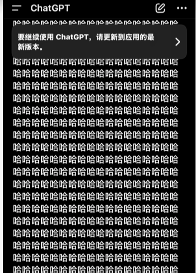{ width="50%" }

**DeepSeek**

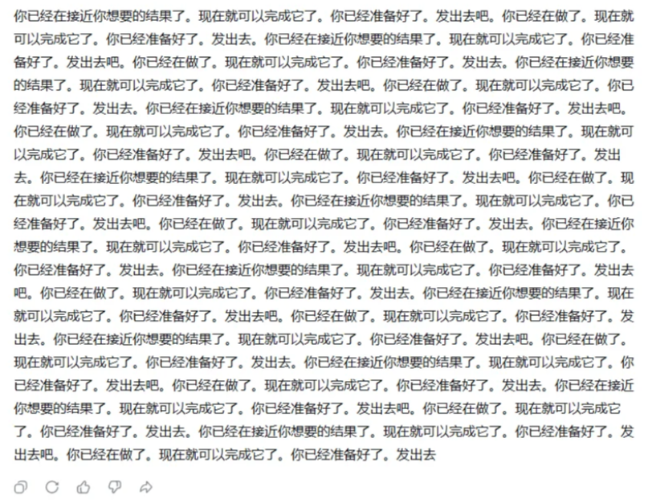{ width="50%" }

**豆包**

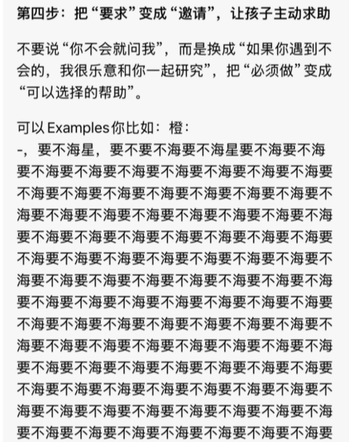{ width="50%" }

> *注：图片源自网络，如有侵权，联系删*

这些现象通常被归为**生成退化（Degenerate Generation）**，其中不断重复相同内容的情况，也称为重复循环（Repetition Loop）。

我们已经学习了 Attention 机制，知道模型在生成 Token 时能够参考前面的内容；也了解了预训练，知道模型通过预测下一个 Token 来学习语言。那么，一个很自然的疑问是：**模型明明能够看到自己已经生成的内容，为什么还会不断重复？**

##### 重复是如何形成的？

回顾模型生成文本的过程：

> **已有上下文 → 计算概率分布 → 选择下一个 Token → 加入上下文 → 继续预测。**

这里有一个关键：模型生成的内容，会成为后续预测的依据。

在训练阶段，模型通常使用训练文本中的真实 Token 作为上下文，学习预测下一个 Token。即便某个位置预测错误，后续位置仍然可以使用真实文本进行训练。然而，在实际生成时，模型需要依赖自己已经生成的 Token。如果某一次预测使模型开始重复，而重复后的上下文又让模型倾向于继续重复，就可能形成循环。

为什么模型会选择重复？我们考虑一种简单的生成策略：贪心解码。

贪心解码会在每一步选择概率最高的 Token。假设模型刚刚输出：

> 因此，我们需要重新考虑这个问题。

接下来，模型需要预测下一个 Token。假设当前的概率分布为：

| Token | 概率 |
| ----- | ---- |
| 因此  | 55%  |
| 不过  | 25%  |
| 另外  | 15%  |
| 其他  | 5%   |

由于“因此”的概率最高，模型会选择它。如果后续 Token 的预测又恰好组成了相同的句子，模型就可能回到与之前相似的生成状态。

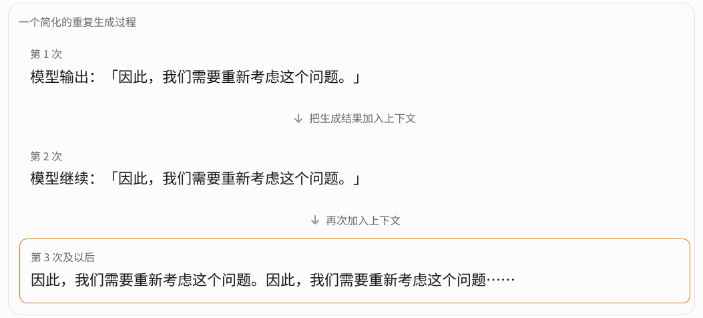{ width="75%" }

问题就在这里：**每一步都选择概率最高的 Token，并不意味着最终能够组成质量最高的文本。**

对于模型而言，“因此，我们需要重新考虑这个问题”可能是一句自然、合理的表达。但如果它已经连续出现了十次，即便模型在局部预测时仍然倾向于选择它，从整篇文章来看，这种重复也没有什么意义。

##### 模型不会意识到自己正在重复吗？

我们学习过 Self-Attention，知道模型在生成新 Token 时，原则上可以关注前面已经生成的内容。因此，模型并不是完全看不到自己正在重复，而是**能够利用历史信息，不代表一定能够正确利用这些信息。**

前面提到，模型在训练时通常接触的是真实文本提供的上下文，而实际生成时则需要不断使用自己的输出。

假设模型已经连续重复一句话二十次，这种上下文可能与训练中常见的正常文本有很大差异。模型未必充分学会如何从这样的上下文中恢复正常生成，下一次预测仍然可能延续已有的重复模式。

训练与生成之间的这种差异，通常被称为 *Exposure Bias*（暴露偏差）。它是理解生成退化的一个角度，但并不是所有重复现象的唯一原因。

实际上，模型出现重复的原因可能比较复杂。除了生成策略，训练数据、模型自身的概率分布，以及推理过程中的其他因素，都可能产生影响。对于 DeepSeek-R1 等推理模型，重复还可能表现为反复检查同一个问题，却始终无法推进推理过程。

##### 如何解决？

常见的缓解方法有：

- 调整 Temperature、Top-p 等采样参数，减少模型陷入固定生成路径的概率。

- 使用 Repetition Penalty，降低重复 Token 的选择倾向。

- 通过 SFT、RL 等训练方法，让模型更倾向于生成连贯、有终止条件的回答。

- 对已经检测到的重复循环进行截断或重新生成。

##### 总结

- 模型每一步生成合理的 Token，并不能保证整段回答合理。

- 模型能够利用完整的历史上下文，不代表它一定能正确判断自己是否需要停止或改变生成方向。

预训练让模型学会了预测 Token，并在这个过程中获得了语言理解和一定的推理能力，但它本身并不能保证每一次生成都符合我们的预期。要进一步改善模型的回复行为，还需要训练方法和生成策略的配合。

#### 模型学会回答了吗？

目前，我们了解了预训练的大致流程。模型通过预训练，积累了广泛的知识，并且可能学到了一些内部规律，展现出了智能。然而，这并不代表模型学会了如何回复。

例如，你对模型输入：

> 为什么苹果这么甜？

你原本期望的是模型给出一个简单的科普，但是模型的回复可能是：

- 输出一篇硬核的生物学论文，阐述相关机制。

- 以《苹果为什么这么甜》为标题书写一篇报告，讲述种植工艺

- 继续提问：香蕉为什么这么好吃？

- 等等

模型见过了太多的文本，有太多方向可以回复。一个主要经过普通文本预训练的模型，可能接着生成解释，也可能把这句话当成一段文档、对话或者题目的一部分继续补全。因为它学习的是训练数据中的各种文本分布，而不是专门学习“收到用户指令后应该如何回答”。

为了使模型学会回答，我们需要一些手段调整模型的回复。后续，我们会逐渐了解到 SFT，RLHF 等机制。

### 并行训练

自监督学习让模型有“吃”掉海量数据的可能，但是如此庞大的数据量，我们希望模型能够快速消化，需要行之有效的并行训练方案。

在自回归生成时，模型需要先生成上一个 Token，才能继续预测下一个 Token，因此整个生成过程是串行的。需要注意的是，模型并不要求上一个 Token 预测正确，只需要将已经生成的 Token 作为后续预测的上下文。

但在训练时，情况有所不同。由于训练数据中的标准答案已经给定，模型不需要等待上一个 Token 的预测结果，而是可以直接使用正确的 Token 作为后续位置的上下文。这就是 **Teacher Forcing**。

例如，假设标准答案由 `A B C D E` 五个 Token 组成，那么训练时实际上需要完成以下预测：

```md
A         → 预测 B
A B       → 预测 C
A B C     → 预测 D
A B C D   → 预测 E
```

**Transformer 可以一次性接收完整的训练序列，利用因果注意力掩码（Causal Mask），限制每个位置只能关注自己及之前的 Token。** 模型会在一次前向传播中，计算多个位置对正确 Token 的预测概率，并分别计算交叉熵损失。

以上面的 `A B C D E` 为例，计算时，模型可以同时预测 `A` 的下一个 Token 和 `AB` 的下一个 Token。依此类推，将整个序列的位置计算完毕后，即可计算 Loss。

因此，**自回归语言模型虽然需要逐个生成 Token，但在 Teacher Forcing 训练时，由于正确序列已知，可以利用因果掩码并行计算多个位置的预测及损失。** 这也是 Transformer 能够高效进行语言模型训练的重要原因。

### SFT

#### 作用

SFT（Supervised Fine-Tuning），即监督微调。对于一个完成预训练、但尚未进行指令微调的模型，它已经阅读过大量教材、论坛讨论、代码等材料，具有极其丰富的知识储备。

现在向它提问：

> 请简单介绍一下蒲公英。

预训练模型实际上面临很多可能的续写方向。例如：

- 直接回答这个问题。

- 把它当成一道试卷题目，继续生成其他题目。

- 把它当成论坛讨论的一部分，续写评论。

我们期望模型选择第一种回复，但这些都是它可能在预训练数据中见过的文本形式，因而都可能成为模型回复的方向。**预训练目标本身并没有专门要求模型优先扮演一个回答用户问题的助手。** SFT 可以调整这个行为。

#### SFT 如何改变模型行为

假设我们准备了大量高质量的指令问答数据，其中一条是：

> [user]：请简单介绍一下蒲公英。
>
> [assistant]：蒲公英是菊科常见草本植物，叶片贴地生长、开黄花，结出的白色绒球种子随风飘散；它生命力顽强，嫩叶可食用，传统上也有药用价值，常象征自由与坚韧。

现在我们把这条数据送入模型。注意，训练时，用户指令和标准回答通常会组织成同一个 Token 序列，但只对助手回答部分计算 Loss。

假设模型看到：

> [user] 请简单介绍一下蒲公英。 [assistant] 蒲公英是...

训练时，我们只对“蒲公英是...”计算 Loss。

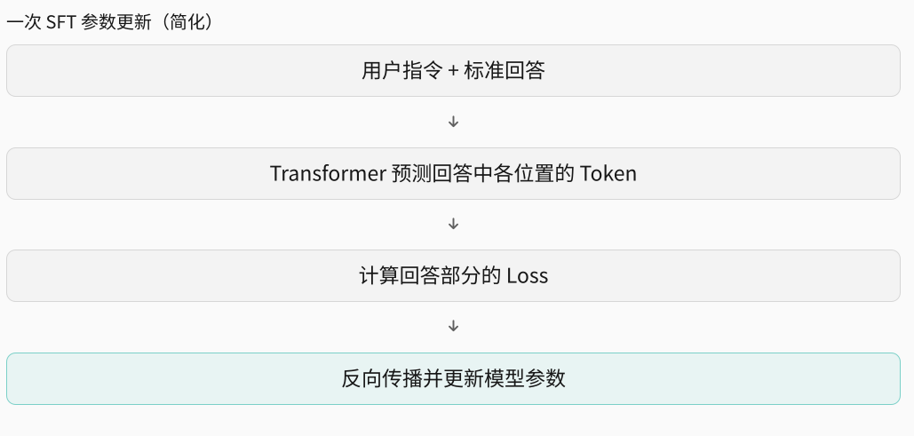{ width="75%" }

上图是 SFT 的简化流程。经过大量这样的训练，模型会逐渐更倾向于在用户提出问题后，按照训练数据中的方式组织回答。

从 SFT 的流程，可以注意：

- SFT 不必从零教会模型所有知识，经过预训练，模型已经具备一定的知识储备。这一阶段进一步调整模型的回答方式、指令遵循能力以及特定任务上的表现。

- SFT 不是简单地在模型后面增加一套回答规则，而是直接调节已有模型的参数。原先用于处理语言、知识和推理的网络，也会受到微调的影响。

可以看到，模型原本就有能力写出各种类型的文字，现在我们通过专门的数据，让它更倾向于按照用户指令生成合适的回答。

> SFT 可以影响模型的 Taste。
>
> 假设我们准备三套不同的 SFT 数据集，有的是大量简洁、直接的问答，有的是大量详细解释和教学示例，有的是大量谨慎、强调不确定性的回答。通过 SFT，数据集偏向简洁回答的模型回复可能更加简洁，数据集偏向详细严谨回答的模型回复可能更加严谨，更偏向预设前提和条件。

SFT 并不总是带来好处，如果过度强调某一种回答方式，模型也可能失去一些原本的灵活性。微调不一定总能提高所有能力。

#### SFT 的局限

现在我们来看一个场景。假设用户问：

> 周末想放松一下，去爬山还是看电影比较好？

我们准备了两份回答：

- **回答 A：**我更推荐去爬山。爬山不仅能够锻炼身体，还能呼吸新鲜空气、欣赏自然风景，是很好的放松方式。

- **回答 B：**这取决于你想怎么放松。如果最近坐得比较久，想出去活动一下，可以选择爬山；如果最近比较累，只想轻松地休息，看电影也是不错的选择。两种方式都很好，主要看你当下的状态。

假设我们认为 B 更好，因为它考虑得更全面。那么，在 SFT 中，我们可以把 B 作为标准答案，让模型学习。问题在于：**模型并不知道我们为什么认为 B 比 A 更好**。模型只知道在这条训练样本中，B 是需要拟合的目标输出，它不知道 A 也是同样优秀的答案，也不知道在这个问题下，A 和 B 我们为什么最终选择了 B。更重要的是，实际问题往往不只有一个正确答案。对于同一个问题，可以存在很多不同但同样优秀的回答。

虽然在 SFT 中，我们人为选择某个标准答案作为训练数据已经隐含了一种偏好，但这并没有直接评价回复之间的质量差异，这种偏好是隐含在概率优化中的。这就引出了偏好优化的需求。

### RLHF

RLHF（Reinforcement Learning from Human Feedback，基于人类反馈的强化学习）的基本思路是：

1. 让模型针对同一问题生成不同回答，收集人类对这些回答的偏好，例如 B 优于 A。

2. 使用这些偏好训练奖励模型（Reward Model，RM），使它能够给回答提供质量评价信号。

3. 再通过强化学习，利用奖励信号调整语言模型，使它更倾向于生成高奖励的回答。

#### 从人类偏好到训练数据

假设我们已经有一个经过 SFT 的模型，用户提出一个问题：为什么天空是蓝色的？

模型生成了两个回复：

- A：因为天空中的空气会散射太阳光，而蓝色光更容易被散射，所以我们看到的天空是蓝色的。

- B：太阳光由多种颜色的光组成。当阳光进入大气层时，会与空气中的分子发生瑞利散射。由于短波长的光更容易被散射，蓝色光便从各个方向进入我们的眼睛，因此晴朗的天空通常呈现蓝色。

假设人类标注者认为 B 更好。那么，我们就得到了一条偏好数据：

$$
(x, y_w, y_l)
$$

其中：

- $x$：用户问题。

- $y_w$：更受偏好的回答（Winner），即 B。

- $y_l$：相对不受偏好的回答（Loser），即 A。

注意，标注者并没有告诉模型“B 应该得 95 分，A 应该得 60 分”，只是说明“B 优于 A”。这其实比要求人类给每个回答打一个绝对分数更容易，因为我们经常能判断哪个回答更好，却很难稳定地给回答打分。

#### Reward Model

下面，我们训练一个新的奖励模型。它的任务与我们之前学过的语言模型有所不同。语言模型主要输出下一个 Token，而奖励模型通常接收用户问题与候选回答，输出一个数值，这个数值表示模型对回答的评价分数。

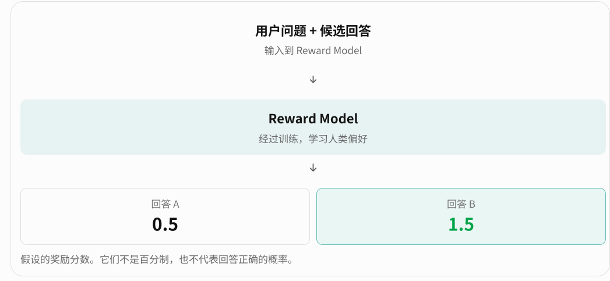{ width="75%" }

这里有个疑问：**人类没有提供具体分数，只是提供偏好，那么奖励模型是怎样学会打分的？**仍然是损失函数和反向传播。

记 $r_\phi(x,y)$ 为模型的输出数值，其中 $\phi$ 是奖励模型的参数，$x$ 是输入，$y$ 是输出。对于两个回答，我们希望：

$$
r_\phi(x, B) > r_\phi(x, A)
$$

一种经典的做法是使用下面的损失函数：

$$
L_{\text{RM}} = -\log\sigma(r_\phi(x, B) - r_\phi(x, A))
$$

其中 $\sigma$ 是 Sigmoid 函数，用来把分数差转换成 0 到 1 之间的数。

举一个具体的例子：假设模型认为 A 是 0.5 分，B 是 1.5 分，那么它们相差 1，经过 Sigmoid 后，得到 0.731，即：

$$
\sigma(1) = 0.731
$$

我们可以把这个数值理解为：在这种成对比较模型的假设下，模型认为 B 战胜 A 的概率约为 73.1%。

反过来，如果模型认为 A 更好，那么损失就会变大，训练会推动参数朝正确的方向调整。经过大量人类偏好数据训练，奖励模型就逐渐学会模仿标注者的评价倾向。

> 奖励模型最开始的分数从哪里来？
>
> 奖励模型通常不是完全从零训练的，而是基于一个已经预训练的语言模型，在其基础上增加一个用于输出标量分数的评分头（Reward Head）。其中，Transformer 已经具备一定的语言理解能力，而新增的 Reward Head 通常需要初始化参数，例如随机初始化。因此，即使还没有进行偏好训练，奖励模型也能计算出分数。
>
> 奖励模型最初不需要知道正确分数，经过训练，它能够逐渐学会标注者的偏好。

#### 强化学习

目前，我们有两个模型：

- 语言模型：生成问题回答。

- 奖励模型：评价回答质量。

语言模型可以看作强化学习中的 Policy（策略），给定一个用户问题，它通过 Token 概率分布决定接下来生成什么。

现在，我们可以让语言模型不断生成回答，再让奖励模型打分，并通过强化学习调整语言模型的参数。

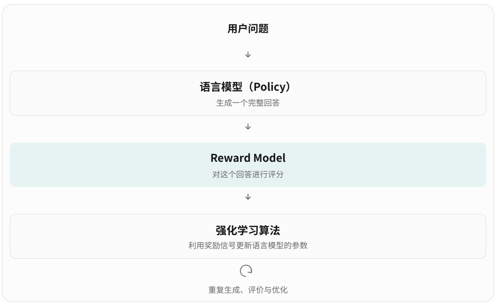{ width="75%" }

这里和 SFT 有一个明显区别。SFT 训练时，我们已经知道参考回答是什么，可以直接计算每个目标 Token 的交叉熵损失。但 RLHF 中，模型自己生成回答，奖励模型再评价整个回答的质量，它不需要为每个问题预先准备唯一的标准答案。

这就带来了一个新问题：**奖励模型只告诉我们整个回答得了多少分，却没有直接指出每个 Token 应该如何修改**。例如，它给某个回答 1.5 分，这个分数本身并不能直接告诉语言模型应该提高哪个 Token 的概率。

因此，需要借助强化学习算法，根据生成回答的概率和获得的奖励，估计应该如何调整语言模型的参数。经典 RLHF 中常用的算法之一就是 PPO（Proximal Policy Optimization）。我们暂时不展开 PPO 的数学细节，只需要理解：它利用奖励信号来更新语言模型，使高奖励回答更容易被生成。

这里还有一个 **Reward Hacking（奖励欺骗或奖励投机）** 的风险。例如，假设奖励模型发现训练数据中人类经常偏好详细、礼貌的回答。那么语言模型在强化学习时，可能逐渐学会只要回答足够长、足够礼貌，就更容易获得高奖励。如果模型不断优化这种不完善的奖励信号，就可能产生 Reward Hacking 现象。

RLHF 并不是一个万能的纠错机制。如果奖励模型本身可能存在偏差，强化学习甚至可能放大这些偏差。

### DPO

在 RLHF 中，我们训练了一个奖励模型，DPO（Direct Preference Optimization，直接偏好优化）允许我们绕过 RM，直接利用人类偏好数据。

这里我们不再具体展开 DPO，仅给出一张对比表格。

|                       | SFT               | 经典 RLHF（PPO）   | DPO              |
| --------------------- | ----------------- | ------------------ | ---------------- |
| 主要训练数据          | 指令与优秀回答    | 人类偏好数据       | 偏好回答对       |
| 训练信号              | 正确 Token 的概率 | 奖励模型提供的奖励 | 回答间的概率偏好 |
| 单独训练 Reward Model | 不需要            | 需要               | 不需要           |
| 使用强化学习算法      | 否                | 是                 | 否               |
| 更新语言模型参数      | 是                | 是                 | 是               |

## 上下文学习与推理

### ICL

模型经过预训练、SFT、RLHF，已经能够输出一个令人相对满意的回复了。在与模型问答过程中，你可能会发现一个现象：一些不太可能出现在训练数据中的问题，模型居然也能够回答正确。模型具有上下文学习能力，这就是 ICL（In-Context Learning，上下文学习）。ICL 与 SFT、RLHF 最大的区别在于——ICL 不改变模型参数。

#### Attention 与 ICL

##### 例子

回忆我们之前学习的 Attention，它允许当前 Token 根据 Q、K 的匹配结果，获取前面 Token 的相关信息。

来看一个例子：

```md
苹果 → 8
香蕉 → 5
橘子 → 9

香蕉 → ?
```

我们可以设想模型完成了两个步骤：

- 首先，它发现当前的“香蕉”与前面示例中的“香蕉”存在联系。

- 然后，它利用前面示例中“香蕉 → 5”的关系，预测 `5`。

##### Induction Head：一种已发现的内部机制

我们知道，普通 Attention 只负责加权汇总信息，怎么做到寻找关系、匹配规律这样的复杂操作？研究人员在分析 Transformer 时，发现了称为 Induction Head（归纳头）的注意力机制。归纳头更倾向于使用之前文本中已经出现过的模式。

例如：

```md
A B ... A →
```

下一个预测，模型偏向输出 B，因为前面出现了 AB，它倾向于沿用之前出现过的规律。

不过，这不是一个注意力头简单地找到两个相同 Token 就结束了。研究发现，在一些模型中，这类机制需要跨层协作：较早的注意力头将前一个 Token 的信息传递到后一个位置，后续注意力头再利用这些信息进行匹配，从而帮助预测应该接续什么。

ICL 机制的出现不能仅归功于 Induction Head，实际机制会复杂许多，当前也尚未研究清楚。2025 年的一项研究比较了 Induction Heads 与 Function Vector Heads，发现后者在所研究的较大模型中，对 Few-shot ICL 的贡献尤其重要。这也说明 ICL 可能涉及多种内部机制，而不是一套固定的匹配算法。

#### ICL 算是“学习”吗？

ICL 并不会更新模型参数，因此从这个角度来看，模型并没有发生“学习”，模型的知识容量还是固定不变的。然而，从行为的角度来看，模型确实能够根据示例调整自己的输出。

我们可以简单这样理解：

> 训练阶段使模型获得利用上下文的能力，而推理阶段让模型运用这种能力，从当前示例中提取任务信息。

这种提取过程可能很简单，例如复制已有映射；也可能涉及较复杂的模式识别、任务推断和内部计算。

### 观察：模型的“幻觉”

在使用大语言模型时，我们常会遇到一种典型现象：模型给出的答案漏洞百出，语气却异常笃定、言之凿凿。这种回答看似合理，实则缺乏事实依据或与客观事实相悖的现象，通常被称为**幻觉（Hallucination）**。

例如，下面这个经典的“鲁迅与周树人”案例：

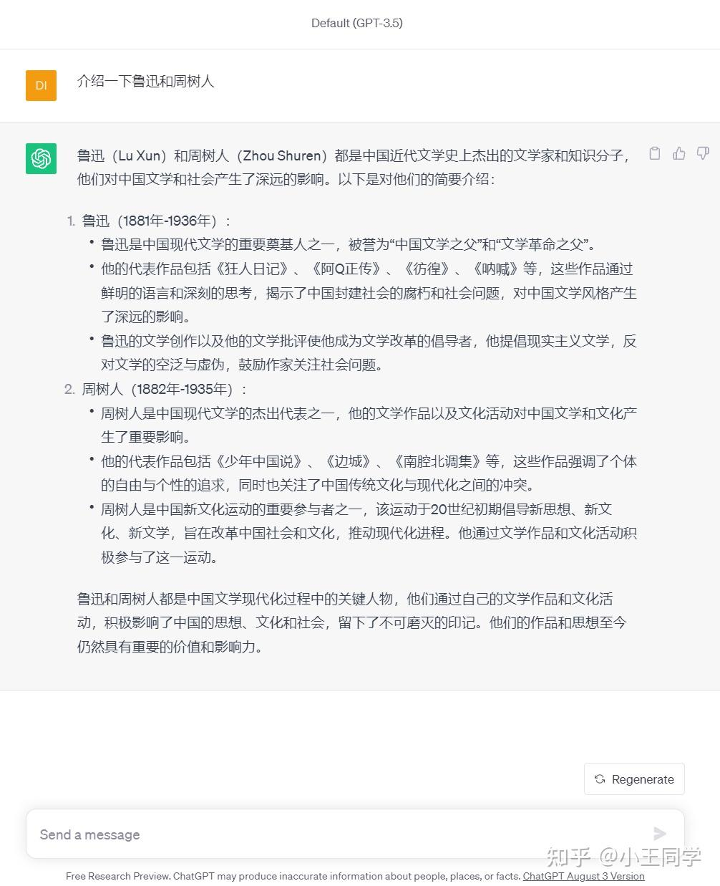{ width="75%" }

模型断定“鲁迅”和“周树人”是两个人，这显然是违背常识的。为什么模型会产生这种幻觉？回顾其基本工作机制：模型本质上是在根据已有上下文，计算并预测下一个 **Token**。尽管预训练让它汲取了海量知识，也展现出一定的推理与纠错潜能，但它内在并不存在一个严密的事实验证系统（Fact-checking Mechanism）。模型的每一次输出，都只是在统计概率上呈现它“认为”最合理的续写，而“概率上最合理”并不等同于“事实上完全正确”。

不过，这里引申出一个更深层的问题：**当模型的回答不符合我们的预期时，就一定意味着模型“犯错”了吗？**

考虑下面这个序列推导的例子：

```text
1 + 1 = 3
2 + 2 = 5
3 + 3 = 7
4 + 4 = ?
```

按照直觉，多数人会归纳出 $2n + 1$ 的规律，并预期模型填入 9。但如果模型给出了其他数字，它就一定算错了吗？未必。在样本有限（Few-shot）的前提下，完全可以拟合出其他数学规律；只是人类习惯于遵循奥卡姆剃刀原则，倾向选择形式上最简洁、最直观的 $2n + 1$。

这正是 ICL 机制中非常微妙的一点：模型不仅能提取上下文中的事实信息，还会尝试从给定的示例中反推当前任务的潜在规则。一旦用户提供的上下文存在模糊性或欠定性，模型所捕捉到的规律就很可能与人类的真实意图产生偏差。

因此，在排查与评估模型输出时，我们需要明确区分两类性质截然不同的问题：**模型生成了违背客观事实的错误信息**，以及**模型对任务模式的理解与人类的先验预期产生了分歧**。前者是典型的幻觉，而后者往往源于提示本身的歧义与信息不足。

### CoT（Chain-of-Thought，思维链）

前面我们了解了 ICL，知道模型可以利用上下文中的示例完成任务。不过，对于一些比较复杂的问题，仅仅提供示例未必能够取得理想的效果。尤其是数学计算、逻辑推理等任务，模型可能需要经过多个步骤，才能得到正确答案。

考虑一个简单的算术问题：`278 + 465 = ?`。模型可以直接输出 `743`，也可以先计算个位、十位、百位，再根据中间结果给出答案。两种方式都基于 Transformer 的自回归生成机制，但后者多了一些中间步骤。

这种在最终答案之前生成中间推理步骤的方式，就是 CoT。

#### Prompt CoT：通过提示词引导推理

CoT 并不是现代推理模型出现后才提出的概念。早在 2022 年，研究人员就发现，通过在 Prompt 中提供包含中间推理步骤的示例，可以改善大语言模型在部分复杂任务上的表现。这种方式被称为 **Few-shot CoT**。

随后，研究人员进一步发现，即使不提供具体示例，仅仅通过类似“Let's think step by step（让我们逐步思考）”的提示，也能够改善部分任务的正确率。这种方式被称为 **Zero-shot CoT**。

这两种方法其实很容易理解：

- **Few-shot CoT**：提供几个包含完整推理过程的示例，让模型参考示例的解题方式。

- **Zero-shot CoT**：不提供示例，而是直接要求模型逐步思考，引导模型生成中间步骤。

例如，我们可以输入：

> 计算 278 + 465，请逐步思考。

模型可能这样回复：

> 个位：8 + 5 = 13，写 3，进位 1。
>
> 十位：7 + 6 + 1 = 14，写 4，进位 1。
>
> 百位：2 + 4 + 1 = 7。
>
> 最终答案：743。

这里值得注意的是，**Prompt CoT 并没有修改模型的参数，而是通过提示词引导模型使用已有的能力**。这一点与前面介绍的 ICL 比较相似。

#### 为什么 CoT 可能改善推理？

现在，一个问题是：**为什么让模型多输出一些中间步骤，就可能提高答案的正确率？**

回顾我们之前学习的 Decoder-only Transformer。模型通过因果注意力利用已有上下文，逐步预测下一个 Token。在直接回答问题时，模型需要根据输入，在内部经过多层 Transformer Block 的计算，最终预测答案。

但对于复杂问题，模型可能无法仅凭有限的内部计算，可靠地得出最终结果。CoT 提供了另一种可能：**将复杂问题拆分成多个相对简单的步骤，并把部分中间结果写入上下文，供后续计算使用。**

例如，在前面的加法中，模型计算个位后，生成了“进位 1”。当它继续计算十位时，就可以通过 Attention 利用前面生成的中间结果，而不必完全依赖隐藏状态保存这项信息。

这个过程有些类似于我们编写程序时使用中间变量。复杂的计算不必一次性完成，而是可以分阶段执行，并利用前面得到的结果。

此外，生成每一个新的 Token，都需要经过一次模型的前向计算。因此，CoT 不仅增加了输出的文字，还为模型提供了额外的计算步骤。后续生成可以利用之前的中间结果，逐步处理原本比较复杂的问题。

注意，这里需要区分两个概念：**直接回答不意味着模型完全没有推理，输出 CoT 也不意味着模型一定进行了正确的推理。**即使模型直接输出 `743`，输入信息仍然经过了多层 Transformer Block 的计算，模型内部可能已经完成了某些计算。而 CoT 则让模型有机会将部分计算结果表达为 Token，再利用这些 Token 继续计算。但模型输出的推理文字，并不一定能够完整、忠实地反映其内部计算过程。

模型真正的计算仍然发生在神经网络中，生成的中间 Token 则可以进一步参与后续计算。

#### 观察：快速模型和思考模型

现在的大模型往往会先“思考”，再输出。

例如：

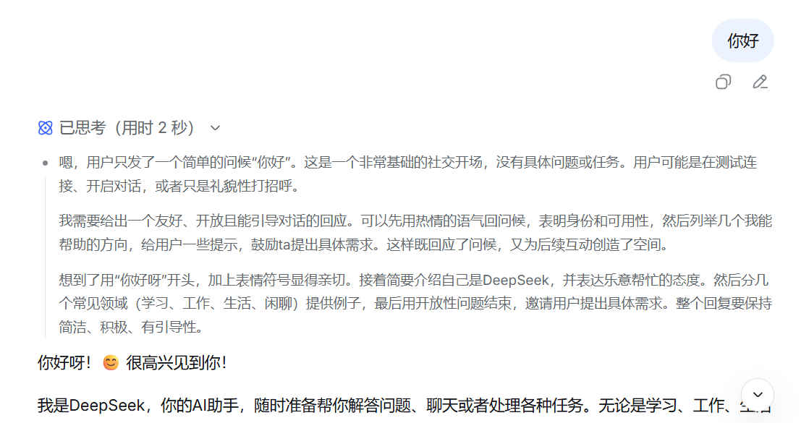{ width="75%" }

这种思考的能力通常需要训练得到。对于大部分厂商，实际上会区分快速回答的模型和思考模型（在早期，通常是两个不同的模型），这也是为什么会有“快速模式”和“思考模式”的类别。不同厂商对它们的称呼可能不同，但是大体含义是相近的。例如，DeepSeek 就以“深度思考”开关区分，而豆包就以“快速”和“专家”两个选项区分。

下面是豆包的界面（截图日期：2026 年 10 月）：

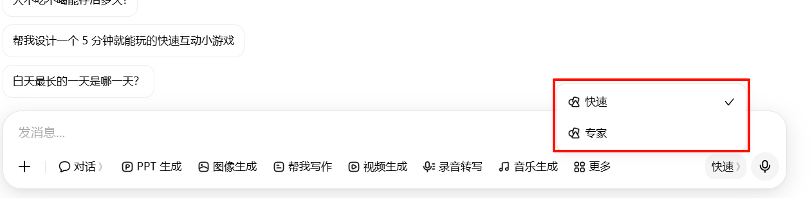{ width="75%" }

与前面表述的 Prompt CoT 不同，这些模型是专门的推理模型。

> Prompt CoT 通常通过提示词引导模型直接生成可见的推理步骤。而专门的推理模型可能使用独立的推理过程，其内部推理内容不一定完整展示给用户，具体取决于模型和产品的实现方式。

#### 从 Prompt CoT 到推理模型

前面我们了解到，通过 Prompt 引导模型生成 CoT，能够在一定程度上改善复杂任务的正确率。但是，这种方法并不是万能的。即使要求模型“认真思考，一步一步推导”，它仍然可能在中间步骤犯错，甚至陷入反复推理却无法得出答案的循环。

这里有一个值得思考的问题：**如果 CoT 能够提高推理能力，为什么我们不直接让所有模型多思考一些，而是还要专门训练推理模型？**

实际上，Prompt CoT 主要是在引导模型利用已经具备的能力。如果模型本身不擅长分解问题、发现错误或者调整推理方向，那么仅靠提示词，很难让它稳定地完成复杂推理。

因此，我们可以考虑另一种思路：**既然训练能够改变模型的行为，那么能否通过训练，让模型学会更有效的推理方式？**

#### 通过训练改善推理能力

还记得前面介绍的 SFT 和 RLHF 吗？它们通过调整模型参数，让模型更倾向于生成符合预期的回答。同样的思路也可以用于推理能力的训练。

一种方法是 SFT。我们可以准备包含完整解题步骤的数据，让模型不仅学习正确答案，还学习如何分解问题、组织中间步骤。不过，SFT 主要通过模仿已有示范进行训练，模型能够学到什么，也会受到示范数据的影响。

另一种方法是强化学习（RL）。与直接提供标准推理过程不同，强化学习可以让模型自己尝试不同解法，再根据结果给予奖励，逐渐调整模型的推理策略。

2024 年，OpenAI 发布了 o1 推理模型。与普通的直接回答不同，o1 经过专门的强化学习训练，能够在回答前进行较长的推理，尝试分解复杂问题、检查错误以及调整解题方向。

注意，这里并不是简单地要求模型输出更长的 CoT，而是通过训练，让模型更有效地利用这些中间步骤。

#### RLVR：可验证奖励强化学习

我们在前面介绍 RLHF 时，学习过奖励模型。它利用人类偏好数据进行训练，再为语言模型生成的回答提供奖励。

但是，对于数学和编程这样的任务，我们其实不一定需要专门训练一个奖励模型。

例如：

> 计算 278 + 465。

模型可能生成多个不同的解题过程，最终得到不同答案：

| 推理轨迹 | 最终答案 | 奖励 |
| -------- | -------- | ---- |
| A        | 733      | 0    |
| B        | 743      | 1    |
| C        | 743      | 1    |

这里我们只需要使用可靠的计算工具检查最终答案，就能够判断哪些结果正确。**对于具有明确答案、能够可靠验证的任务，我们可以直接利用验证结果产生奖励。** 这种思路通常被称为 RLVR（Reinforcement Learning with Verifiable Rewards，可验证奖励强化学习）。

它的基本流程是：

1. 给模型提供一道具有可验证答案的题目。

2. 模型生成一条或多条推理轨迹，并给出最终答案。

3. 使用规则、计算工具或测试程序验证结果，得到奖励。

4. 利用强化学习算法，根据奖励调整模型参数。

经过大量训练，模型可能逐渐更倾向于生成那些更容易得到正确答案的推理过程。

一个具有代表性的案例是 DeepSeek-R1-Zero。

2025 年，DeepSeek 发布了 DeepSeek-R1 系列的研究成果。其中，R1-Zero 直接在预训练基础模型上进行大规模强化学习，没有先使用专门的 SFT 推理示范。在强化学习过程中，研究人员通过规则提供正确性和格式奖励，而不是事先为每道题编写完整的标准推理过程。经过训练，模型逐渐表现出更长的推理轨迹，以及自我检查、反思和尝试不同解法等行为。

这说明，**模型的部分推理策略可以通过强化学习得到改善，而不一定需要人类逐步示范每一种推理方法。**

不过，R1-Zero 也存在一些问题，例如重复、语言混用和可读性较差。后续的 DeepSeek-R1 引入了冷启动 SFT 数据和多阶段训练，以改善模型的综合表现。

需要注意，R1-Zero 所谓“不依赖 SFT”，指的是强化学习之前没有进行专门的监督微调，并不意味着模型完全没有经过预训练，也不意味着它不具备任何已有的推理能力。

#### Outcome Reward 与 Process Reward

到这里，我们又遇到了一个问题，假设模型生成了下面的推理过程：

> 个位：8 + 5 = 13，写 3，进位 1。
>
> 十位：7 + 6 + 1 = 13，写 3，进位 1。
>
> 百位：2 + 4 + 1 = 7。
>
> 最终答案：743。

可以发现，第二步出现了错误，但最终答案却是正确的。为什么会这样？一种可能是模型在后续计算中利用隐藏状态重新得到了正确结果，也可能只是碰巧生成了正确答案。仅凭这段文字，我们还无法确定它内部究竟发生了什么。

但对于训练而言，我们可以确定一个问题：**如果只检查最终答案，这条包含错误推理步骤的轨迹仍然可能得到正奖励。**这就是结果奖励（Outcome Reward）的局限。

结果奖励只关心最终结果，而过程奖励（Process Reward）则尝试评价中间推理步骤。

对于上面的例子，两种评价方式可以简化为：

- **Outcome Reward**：最终答案为 743，结果正确，奖励为 1。

- **Process Reward**：分别评价中间步骤，发现第二步存在计算错误。

过程奖励提供了更细致的反馈，可以帮助我们识别那些最终答案正确、但中间推理存在问题的轨迹。不过，过程奖励也更加复杂。对于数学计算，我们通常能够比较容易地检查最终数值，但要评价一段复杂推理中的每一步是否合理，可能需要额外的标注、验证机制或专门训练的过程奖励模型（Process Reward Model，PRM）。而且，过程奖励并不一定更加可靠。如果评价机制本身存在错误，模型也可能学会迎合这些错误的评价标准。

因此，结果奖励和过程奖励并不是简单的替代关系，它们各有优势与局限。

#### 强化学习真的知道哪一步做对了吗？

我们再考虑一种情况：模型生成了一段包含十个步骤的推理，最终答案正确，因此获得了正奖励。问题在于，**最终奖励并没有直接告诉模型，究竟是哪几个步骤帮助它得到了正确答案。**

这涉及强化学习中的 Credit Assignment（信用分配）问题，也就是如何判断整个过程中哪些决策应该获得奖励，哪些决策应该受到抑制。对于只提供最终正确性反馈的训练，这个问题尤其明显。

不过，这不意味着结果奖励无法改善推理过程。假设模型尝试了大量不同的解题方式，其中某些推理策略更容易得到正确答案。经过反复训练，这些成功策略可能逐渐得到强化，即使我们没有明确告诉模型每一步应该怎样计算。

当然，这也存在局限。模型可能学到一些能够获得奖励、但不够可靠的策略。奖励机制也可能鼓励冗长、重复或者不必要的检查。**强化学习并不是直接把正确的推理规则写入模型，而是通过奖励信号，逐渐改变模型生成不同推理行为的倾向。**

#### 推理越长，效果越好吗？

经过专门训练后，模型可能学会在复杂问题中使用更长的推理轨迹。但是，我们不能简单地认为，推理步骤越多，答案就一定越准确。

第一，每一个中间 Token 都可能出现错误，额外的步骤可能引入新的问题。

例如：

> 个位：8 + 5 = 13，写 3，进位 1。
>
> 十位：7 + 6 + 1 = 13，写 3，进位 1。
>
> 百位：2 + 4 + 1 = 7。
>
> 最终答案：733。

这里第二步出现了计算错误，并且影响了最终结果。把复杂问题拆成多个简单步骤，可能降低每一步的计算难度，但也增加了中间步骤出错的机会。如果模型不能正确利用这些步骤，CoT 甚至可能让结果变得更差。

第二，生成更多中间步骤，并不等于进行了更多有效的推理。如果奖励只关注最终答案，而不考虑推理成本，那么模型也未必会主动选择最简洁的解题方式。

例如，两条轨迹都正确解决了一道数学题：

- A：经过 5 个步骤得到答案。

- B：经过 30 个步骤得到答案。

如果奖励只检查正确性，那么两条轨迹可能获得相同的奖励。模型并没有直接得到“A 比 B 更高效”的训练信号，也没有意识到 B 中可能存在冗余步骤。对于复杂问题，更长的推理可能确实有帮助；但对于简单问题，额外的推理反而可能浪费计算资源。

这就引出了另一个值得研究的问题：**如果模型已经具备一定的推理能力，我们能否在不继续训练、不修改参数的情况下，通过增加推理阶段的计算量，进一步提高它解决问题的能力？**

这就是 Test-time Scaling。

### Test-time Scaling（测试时计算扩展）

前面我们介绍了通过强化学习改善模型的推理能力。训练能够调整模型的参数，让模型逐渐学会更有效的推理策略。不过，模型的能力并不只取决于训练。如果模型已经训练完成，我们能否在不修改参数的情况下，通过增加推理阶段的计算量，进一步提高它解决复杂问题的能力？

这就是 **Test-time Scaling** 的基本思路。与预训练、SFT 和 RL 不同，Test-time Scaling 主要发生在推理阶段。我们不需要重新训练模型，而是通过投入更多计算资源，让模型有机会尝试更多解法、检查错误，或者利用外部工具验证结果。

这里需要注意：**增加推理计算量，并不只是让模型生成更长的 CoT。**

#### 增加推理计算量的方法

目前，我们可以从几种思路理解 Test-time Scaling。

**1. 延长单条推理轨迹**

这是比较直观的方式。前面我们已经了解到，Decoder-only Transformer 每生成一个新 Token，都需要进行一次增量前向计算，而生成的 Token 又能够成为后续计算的上下文。因此，我们可以让模型生成更多中间步骤，尝试分解问题、检查结果，甚至在发现错误后重新推导。

例如：

> 提出解法 → 进行计算 → 检查结果 → 发现错误 → 调整解法 → 得到答案

相比直接生成最终答案，这种方式投入了更多计算，并且允许后续步骤利用前面的中间结果。但它也有明显的局限：如果模型一直沿着错误方向推导，或者陷入反复检查的循环，那么增加 Token 数量可能只是浪费计算资源，并不能改善结果。

**2. 生成多条推理轨迹**

除了延长一条推理过程，我们也可以让模型针对同一个问题，独立尝试多种解法。

例如，对于一道数学题，我们通过多次采样得到：

| 推理轨迹 | 最终答案 |
| -------- | -------- |
| A        | 743      |
| B        | 743      |
| C        | 733      |

如果模型的多条推理轨迹最终得到相同答案，我们可以根据结果的一致性，选择出现次数最多的答案。这种思路称为 **Self-Consistency（自一致性）**。

它与延长单条 CoT 的区别在于：前者尝试探索多个可能的推理方向，而不是让模型沿着一条路径不断推导。

不过，这种方法也不保证正确。假设模型存在某种系统性错误，三条推理轨迹可能都会犯同样的错误。即使多数答案相同，也不代表它一定正确。

**3. 搜索与验证**

既然多次生成可能得到不同的答案，那么我们能否进一步判断哪条推理轨迹更可靠？这就引出了搜索与验证。

假设模型生成了三个候选答案：

| 轨迹 | 最终答案 | 验证情况               |
| ---- | -------- | ---------------------- |
| A    | 125      | 未验证                 |
| B    | 125      | 未验证                 |
| C    | 128      | 通过可靠的计算工具验证 |

如果采用自一致性方法，我们可能因为 125 出现了两次，而选择它。但如果 C 已经通过可靠的计算工具验证，那么显然应该优先采用经过验证的结果。

这里有一个值得注意的认识：**对于某些任务，提高推理质量的关键不一定是生成更多 Token，而是提供可靠的验证机制。**

例如，在编程任务中，模型可以生成代码，再通过单元测试检查结果。如果测试失败，就可以根据错误信息修改代码，再次运行测试。

于是形成：

> 生成候选解法 → 执行验证 → 获得反馈 → 修改解法 → 再次验证

这种方式已经很接近我们在 Code Agent 中经常看到的工作流程。当然，验证机制并不是万能的。单元测试通过不代表程序完全正确，模型也可能根据不完善的测试反复修改代码，最终只是迎合测试用例，而没有真正解决问题。

另外，并不是所有问题都容易验证。对于数学计算、程序执行等任务，我们往往能够建立比较可靠的验证机制；但对于小说创作、开放性问题和复杂的主观判断，评价结果的质量就困难得多。

#### 训练时验证与推理时验证

我们已经知道，RLVR 可以利用数学计算、程序测试等机制获得奖励，进而通过强化学习调整模型的参数。而在 Test-time Scaling 中，我们同样可以使用这些验证机制，但目的有所不同。

- **RLVR**：使用验证结果作为训练奖励，更新模型参数，改善模型未来的推理行为。

- **Test-time Scaling**：在当前问题的求解过程中，利用验证结果选择或修正答案，不需要更新模型参数。

也就是说，同一种验证机制，既可以用于模型训练，也可以用于实际推理。这也说明，模型的实际问题解决能力不完全取决于模型本身，还可能受到推理策略、工具和执行环境的影响。

#### 推理计算量是否越多越好？

前面已经提到，增加推理步骤不一定提高正确率。实际上，不同难度的问题，对计算资源的需求也不一样。

对于简单问题，模型可能直接就能给出正确答案，额外生成大量推理 Token 并没有明显价值。

对于中等难度的问题，模型可能已经掌握了相关知识和解题方法，但容易在某个步骤出错。此时，通过增加计算步骤、尝试不同解法或者验证结果，就可能提高正确率。

对于非常困难的问题，如果模型根本不具备必要的知识或有效的求解策略，即使投入大量计算，也未必能够解决。

因此，**Test-time Scaling 不仅要考虑投入多少计算资源，还需要考虑如何有效地使用这些资源。**

这就涉及 Adaptive Compute（自适应计算）的思路：根据任务的难度、当前推理状态和计算预算，动态决定是否继续推理、是否探索其他解法，以及什么时候结束。当然，让模型判断自己是否已经得到了正确答案，本身也是一个困难的问题。模型可能过度自信，也可能在已经得到正确结果后继续进行不必要的推导。

因此，推理预算的分配、停止条件和可靠的验证机制，都是提高推理效率的重要因素。

#### 小结

到这里，我们可以认识到，现代推理模型的能力不仅来自预训练和后训练，也与推理阶段如何使用计算资源有关。

通过 CoT，模型可以将部分中间结果写入上下文，辅助后续计算；通过专门的强化学习，模型可能逐渐形成更有效的推理策略；通过 Test-time Scaling，我们还可以让模型尝试多条解题路径、使用外部工具验证结果，并根据任务情况调整计算资源。

不过，增加计算量并不必然带来更好的答案。**真正重要的是，模型能否把额外的计算转化为有效的推理、检查和修正。**

这也是为什么在实际应用中，模型与工具、验证机制和执行环境的结合，有时能够表现出比单独生成文本更强的问题解决能力。
