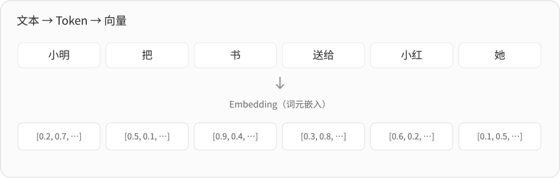
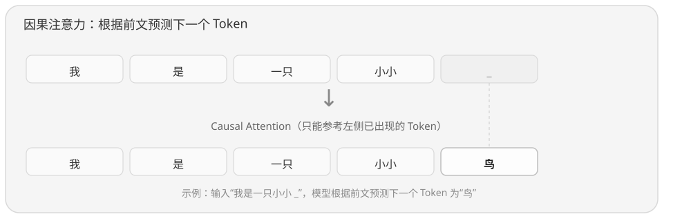
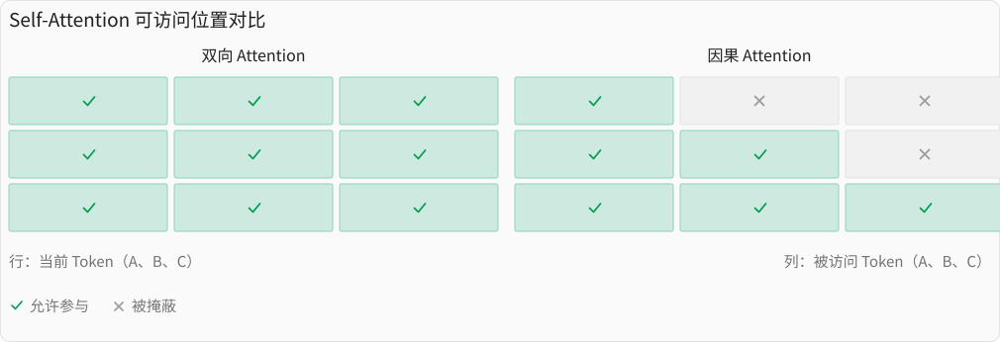
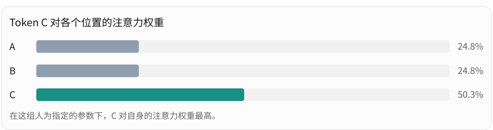
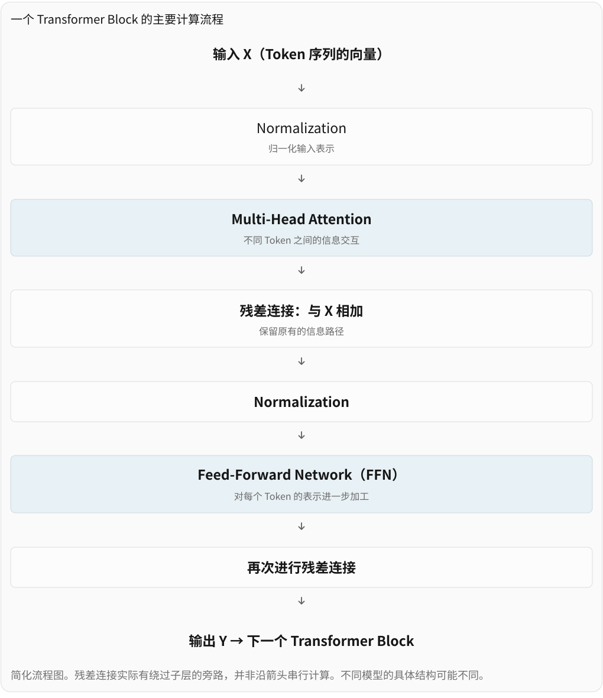
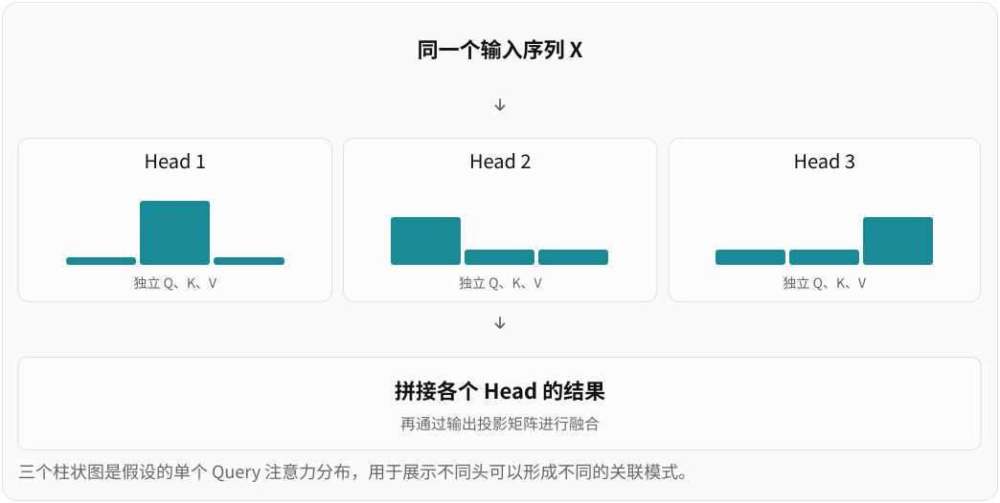

# LLM 学习笔记（一）：从 Token 到 Transformer

## 大语言模型 / LLM

自 2022 年 ChatGPT 横空出世以来，大语言模型（Large Language Model，简称 LLM，也常被称为“大模型”）已经逐渐融入我们的日常生活。不知你是否好奇过：**大模型的智能究竟从何而来？**

或许你看过一些科普视频，知道大模型其实是一个“概率机器”“模式匹配器”。在网络上，也有人把它称为“大型输入法”，甚至是“大号搜索引擎”。

这些说法并非毫无根据。大模型确实会通过预测下一个 Token 来生成内容，也会从大量训练数据中学习各种模式。但如果仅仅把它理解为简单的概率预测或模式匹配，似乎又不足以解释它表现出来的一些能力。

例如：**大模型为什么能够计算从未见过的数学题？**

如今（2026 年），大模型已经能够快速完成不少数学计算。对于下面这道加法题，笔者使用 DeepSeek Flash 进行了测试：

$$
56753714720274181902 + 19768724696015213560
$$

模型在没有开启显式推理模式、没有调用计算工具的情况下，直接给出了正确答案：

$$
76522439416289395462
$$

> 测试条件：DeepSeek V4.1 Flash、Temperature = 0、未开启显式推理、未调用外部工具、提示词缓存未命中。

对于一些小数字运算，模型很可能已经在海量的训练数据中见过，因此往往能够正确回答。例如 $99 + 3$，模型可以不假思索地回答出 $102$。正如我们背诵乘法表一样，模型可能通过训练形成了自己的“计算表”。

对于前例，两个加数都有 20 位，互联网上恰好出现完全相同算式的概率几乎为 0。我们不妨做一个简单的概率估算：假设互联网上存在 30 亿道加法算式，并且每道算式的两个加数，都是在相应位数的整数中独立、均匀地随机选取的。

那么，一道特定的加法算式在其中出现的概率大约是：

| 两个加数的位数 | 特定算式的期望出现次数 | 至少出现一次的概率      |
| -------------- | ---------------------- | ----------------------- |
| 6 位           | 0.003704               | 0.370%                  |
| 7 位           | 0.00003704             | 0.003704%               |
| 8 位           | 0.0000003704           | 0.00003704%             |
| 10 位          | $3.7\times10^{-11}$    | 约 270 亿分之一         |
| 15 位          | $3.7\times10^{-21}$    | 约 $3.7\times10^{-19}\%$ |

> 这只是基于简化假设的理论估算，未必准确，但已足够说明：对于足够大的整数，想要通过记住所有算式及其答案来完成计算，几乎是不可能的。

那么，大模型究竟是如何计算的？显然，**预测下一个 Token，并不意味着模型内部只能进行简单的查找或匹配。**经过训练，模型可能学会了一些能够应用到新输入上的计算规律。即使没有见过某道具体的算式，它也可能利用学到的规律计算出答案。

换句话说，概率预测描述的是模型生成内容的方式，却没有完整解释模型内部是如何处理信息、完成计算的。

那么，这些能力究竟是如何产生的？

笔者也曾对这个问题十分好奇，因此尝试了解了一些 LLM 的内部机制。这篇笔记将从 Transformer 和注意力机制入手，结合一些例子、公式以及个人的理解，尝试回答这个问题。

## Transformer

如今，主流大语言模型大多建立在 Transformer 架构之上。Transformer 最早由 Google 的研究人员在 2017 年发表的论文《Attention Is All You Need》中提出。其中，一个非常重要的机制就是 **Attention（注意力机制）**。

Attention 并非 Transformer 的全部，但却值得我们先从这里切入。

### Token：从文本到向量

Token（词元）是 LLM 处理文本的基本单位。

假设我们有一句话：

> 小明把一本书送给了小红，因为她很喜欢读书。

对人来说，我们容易理解：

- “小明”是送书的人

- “小红”是收到书的人

- “她”大概率指的是“小红”

但对于 LLM 来说，最初接收到的只是文本。神经网络不能直接拿汉字进行计算，因此需要先将文本拆分成 Token，再将每个 Token 转换成向量。

例如，一种可能的拆分和转换过程：

> 请注意，Token 与汉字、词语并没有严格的一一对应关系。一个 Token 可能是一个汉字、几个汉字，甚至是词语的一部分。具体如何拆分，取决于模型使用的 Tokenizer。

经过这一过程，每个 Token 都会获得一个初始的向量表示。这些向量并不是随意生成的，而是由模型在训练过程中学习得到的。

这样，原本无法直接参与神经网络计算的文本，就转化成了一组可以计算的数字。

现在，模型能够看懂文字（也即 Token）了，但是要理解这句话，除了需要处理每个 Token 本身的信息，还需要理解它们之间的关系。例如，“小明”与“送”有关，“小红”与“收到书”有关，而“她”又可能指向“小红”。

**那么，模型是如何建立这些关系的呢？**

### 如何找到有关的信息？

我们暂时不考虑 Transformer 的具体实现，先思考一个简单的问题：

> 假设你正在处理句子中的“她”，希望从上下文中找到与它有关的信息。

为了方便理解，我们先将“小明”“小红”“书”“她”分别视为一个整体，并假设它们对应的向量为：

- 小明：$x_1$

- 小红：$x_2$

- 书：$x_3$

- 她：$x_4$

一个很自然的想法是：计算“她”与其他向量的相似程度。例如，我们可以使用点积来计算一个关联分数：

$$
s_{ij}=x_i\cdot x_j
$$

这里的 $x_i$ 和 $x_j$ 分别表示两个向量。点积的计算结果是一个数，可以用来衡量两个向量的匹配程度。

假设计算“她”与其他向量的点积，得到：

- 小明：0.2

- 小红：0.9

- 书：0.1

> 这里的分数均为假设。在这个例子中，我们暂时将更大的点积视为更强的关联，但点积本身并不直接等于语义相似度或概率。

从结果来看，“她”与“小红”的关联最强。因此，在处理“她”时，我们应该更多地参考“小红”的信息。事实上，这个思路已经比较接近 Attention 了。

前面，我们直接使用 Token 的向量计算关联分数。如果需要进一步汇总上下文的信息，似乎也可以根据这些分数，对相应的向量进行加权求和。但是，这意味着我们使用同一套向量，既决定应该参考什么信息，又决定最终传递什么信息，**然而很多时候，我们用来寻找信息的依据，与最终希望获得的信息并不一致。**

例如：

- 查询通讯录时，我们根据**姓名**找到对应的联系人，但最终需要的是他的**电话号码**。

- 查看天气预报时，我们因为预报中提到了自己所在的**城市**而关注它，但真正需要的是这个城市的**降雨时间、气温**等信息。

那么，能不能为不同的用途准备不同的向量表示？这也是为什么 Attention 中会有 Q、K、V。

### Q、K、V

在 Attention 中，有三个重要的概念：

| 概念       | 作用                         |
| ---------- | ---------------------------- |
| Query（Q） | 表示当前位置希望寻找什么信息 |
| Key（K）   | 提供用于匹配的信息           |
| Value（V） | 提供最终参与汇总的信息       |

还是前面的例子，当模型处理“她”时，可以利用“她”的 Query，与“小明”“小红”“书”等位置的 Key 进行匹配，判断应该参考哪些位置。假设“小红”的匹配分数最高，那么最终汇总信息时，“小红”对应的 Value 就可能占据更大的权重。

注意，**Query、Key 和 Value 并不是三种不同的 Token，而是同一个输入可以具有的三种不同表示。**

那么，**Q、K、V** 从哪里来？我们之前说过，输入模型的是一组 Token 对应的向量，并没有什么天然的 Q、K、V。实际上，Q、K、V 都是通过对输入向量进行不同的线性变换得到的。

对于一个输入向量 $x$，可以写成：

$$
\begin{aligned}
q &= xW_Q \\
k &= xW_K \\
v &= xW_V
\end{aligned}
$$

这里：

- $x$ 是当前输入的向量表示。

- $W_Q$ 是用于生成 Query 的参数矩阵。

- $W_K$ 是用于生成 Key 的参数矩阵。

- $W_V$ 是用于生成 Value 的参数矩阵。

这三个矩阵中的参数，都是模型在训练过程中学习得到的。

因此，同一个输入向量 $x$，经过不同的变换后，就能够得到三个不同用途的向量。

例如，对于“小红”这个位置，模型既可以生成用于匹配的 Key，也可以生成用于传递信息的 Value。而对于“她”这个位置，也同样可以生成自己的 Query、Key 和 Value。

通过这样的设计，模型就不必使用完全相同的向量，同时承担匹配和信息传递两种任务。

### Attention 如何计算？

现在，我们已经有了 Q、K、V，接下来就可以计算 Attention 了。

整个计算可以分成三个主要步骤：计算匹配分数、分数转化为权重、根据权重汇总信息。

#### 第一步：计算匹配分数

当我们处理“她”时，可以使用它的 Query，与其他位置的 Key 计算点积：

$$
s_j=\frac{q_{\text{她}}\cdot k_j}{\sqrt{d_k}}
$$

这里：

- $q_{\text{她}}$ 是“她”对应的 Query。

- $k_j$ 是某个可参考位置的 Key。

- $d_k$ 是 Key 向量的维度。

> 为什么要除以 $\sqrt{d_k}$？
>
> 因为向量维度比较大时，点积的数值可能变得很大。除以 $\sqrt{d_k}$ 可以控制分数的尺度，使后续的计算更加稳定。

#### 第二步：将分数转换为权重

前面算出的分数，还不能直接理解为各个位置所占的比例。

因此，Attention 使用 Softmax 函数，将这些分数转换成一组非负、总和为 1 的权重：

$$
a_j=\frac{e^{s_j}}{\sum_t e^{s_t}}
$$

例如，假设经过 Softmax 后，我们得到：

- 小明：0.2

- 小红：0.7

- 书：0.1

那么就可以理解为：在这次信息汇总中，“小红”提供的信息占据了更大的权重。

#### 第三步：根据权重汇总信息

得到权重后，就可以对相应位置的 Value 进行加权求和：

$$
z_{\text{她}}=\sum_j a_jv_j
$$

例如，对于前面的假设结果：

$$
z_{\text{她}}=0.2v_{\text{小明}}+0.7v_{\text{小红}}+0.1v_{\text{书}}
$$

这样，我们就得到一个新的向量，它不再只是“她”原本的输入表示，而是汇总了相关上下文信息的结果。

这就是 Attention 最核心的思路：**根据当前位置的需求，动态决定应该参考哪些信息，再将这些信息汇总起来。**

### 完整的 Attention 公式

前面我们是以“她”这一个位置为例，逐步解释计算过程。实际上，Transformer 可以将多个位置的计算组织成矩阵运算。

经典的缩放点积注意力公式是：

$$
\operatorname{softmax}  
\left(  
\frac{QK^{\mathsf T}}{\sqrt{d_k}}  
\right)V
$$

这是 2017 年[《Attention Is All You Need》](https://arxiv.org/abs/1706.03762)论文中使用的核心公式。

现在看这个公式容易理解：

- $QK^{\mathsf T}$：计算 Query 与 Key 之间的匹配分数。

- $\sqrt{d_k}$：对分数进行缩放。

- $\operatorname{softmax}$：将分数转换成权重。

- $V$：根据权重对 Value 进行加权求和，得到新的表示。

上面的例子实际上描述的是 Self-Attention（自注意力），即 Query、Key 和 Value 都来自同一组输入。自注意力并不意味着每个 Token 都能参考所有位置，在 GPT 这类自回归语言模型中，模型会根据已有的 Token，逐步预测下一个 Token，即当前位置不能提前参考未来的信息。

为此，Transformer 可以使用 Causal Mask（因果掩码），屏蔽未来位置，使每个 Token 只能参考自己和之前的 Token。这种方式称为 Causal Self-Attention（因果自注意力）。

> GPT 类自回归模型有：ChatGPT，Claude，DeepSeek 等系列模型

至此，我们已经初步了解了 Attention 的计算过程。

### 因果自注意力与因果掩码

前面我们了解了基本的 Attention 机制及计算，在上一节末尾，我们提到因果自注意力。现代主流自回归 LLM 通常采用因果自注意力，并通过预测下一个 Token 的任务进行训练。

因果自注意力涉及序列先后关系的利用，回想我们最初的例子：

> 小明把一本书送给了小红，因为她很喜欢读书。

假设我们在处理“她”，我们根据 Q、K、V 可以推算“她”与“小红”关系最大。这里我们将 Token 进行了相似度匹配，但却没有利用到位置信息。

来看这两个例子：

> ① 小明喜欢小红。
>
> ② 小红喜欢小明。

如果完全没有位置信息，普通 Self-Attention 本身其实无法区分这两种排列所表达的顺序关系，因为仅仅改变 Token 位置，并不会凭空改变他们的内容向量。

Transformer 需要利用序列的位置信息和先后关系，例如：

- 旋转位置编码（RoPE）：提供位置相关的信息。

- 因果掩码（Causal Mask）：限制不同位置之间的信息访问范围。

因果掩码是另一种机制，也是本节的重点。对于普通的双向 Self-Attention，每个位置原则上可以访问序列中的所有位置。而 GPT 这类自回归语言模型使用 Causal Mask（因果掩码），让每个位置只能访问自己及之前的位置。

假设序列是 A、B、C：

因此在因果 Attention 中：

$$
\begin{aligned}
z_1 &= v_1\\
z_2 &= a_{21}v_1+a_{22}v_2\\
z_3 &= a_{31}v_1+a_{32}v_2+a_{33}v_3
\end{aligned}
$$

其中每一行的权重之和都是 1。可以发现：

- A 只能利用 A。

- B 可以利用 A、B。

- C 可以利用 A、B、C。

注意，因果掩码通常不是阻止 Q、K、V 的计算，而是在 QK 匹配分数上施加限制。被掩蔽的位置经过 Softmax 后，其注意力权重为 0，自然也不会参与该位置的 Value 汇总。

现在回过头来看：

> ① 小明喜欢小红。 /  ② 小红喜欢小明。

可以发现，当 Token 的排列顺序发生变化时，各个位置能够参考的前文也会发生变化。这使因果注意力具有了利用序列先后关系的能力。

到这里，我们应该能够明白为什么模型能够区分这两个句子了。

### 一次 Self-Attention 的计算

我们手工计算一次 Self-Attention。

#### 假设输入

假设输入序列是：

> 我 喜欢 你

为了简化，假设这句话被拆分为三个 Token，分别记作 A、B、C。

每个 Token 被一个二维向量表示：

- $x_A=[1, 0]$

- $x_B=[0,1]$

- $x_C=[1,1]$

将它们合并，那么输入矩阵为：

$$
X=
\begin{bmatrix}
1&0\\
0&1\\
1&1
\end{bmatrix}
$$

#### 计算 Q、K、V

我们知道：

$$
Q=XW_Q,\quad K=XW_K,\quad V=XW_V
$$

现在，人为指定这三个矩阵：

$$
\begin{aligned}
W_Q &=
\begin{bmatrix}
1&0\\
0&1
\end{bmatrix}
\\[12pt]
W_K &=
\begin{bmatrix}
0&1\\
1&0
\end{bmatrix}
\\[12pt]
W_V &=
\begin{bmatrix}
2&0\\
0&1
\end{bmatrix}
\end{aligned}
$$

这三个矩阵的作用：

- $W_Q$：保持向量不变。

- $W_K$：交换两个维度。

- $W_V$：把第一个维度放大两倍。

> 实际模型中的权重是训练得到的，我们这里仅为了演示计算过程。

把每个 Token 的向量分别乘以这三个矩阵，就得到：

| Token | Q      | K      | V      |
| ----- |:------ | ------ | ------ |
| A     | [1, 0] | [0, 1] | [2, 0] |
| B     | [0, 1] | [1, 0] | [0, 1] |
| C     | [1, 1] | [1, 1] | [2, 1] |

#### 计算 Q、K 的匹配分数

假设我们正在处理 C，我们有$q_C=[1, 1]$，分别计算：

- $q_C \cdot k_A = 1$
- $q_C \cdot k_B = 1$
- $q_C \cdot k_C = 2$

因此得到：

$$
[1,1,2]
$$

Attention 需要除以 $\sqrt{d_k}$，这里 Key 的维度是 2，所以计算：

$$
\frac{1}{\sqrt{2}}[1,1,2]
\approx[0.707,0.707,1.414]
$$

使用 Softmax 将它们转换成非负且总和为 1 的权重：

$$
[0.248,\ 0.248,\ 0.503]
$$

#### 使用权重汇总 V

根据：

$$
[0.248,\ 0.248,\ 0.503]
$$

计算：

$$
z_C=0.248v_A+0.248v_B+0.503v_C
$$

得到：

$$
z_C\approx[1.503,\ 0.752]
$$

到这里，我们已经完成了一次 Attention 的计算。当然，这只是 Attention 这一部分的输出，实际 Transformer 还会进行输出投影、残差连接等操作，并不直接用它替换原始向量。

#### A 和 B 如何计算？

我们使用因果掩码，这意味着：

- A 只能访问 A。

- B 能访问 A、B。

- C 能访问 A、B、C。

把三个位置的注意力权重合并成一个矩阵：

$$
\operatorname{softmax}
\left(
\frac{QK^{\mathsf T}}{\sqrt 2}+M
\right)
=
\begin{bmatrix}
1&0&0\\
0.670&0.330&0\\
0.248&0.248&0.503
\end{bmatrix}
$$

其中 $M$ 就是因果掩码矩阵，允许访问的位置加 0，不允许的位置加 $-\infty$。

具体的计算过程不再展开，整体流程与此前一致，结果是：

$$
Z\approx
\begin{bmatrix}
2&0\\
1.340&0.330\\
1.503&0.752
\end{bmatrix}
$$

到这里你应该能够体会：

> **A 的输出只能受到 A 的影响，而 C 的输出可以同时受到 A、B、C 的影响。**

请思考：

- 假设我们仅修改 B 向量，从$[0,1]$改为$[1,1]$，输出会如何变化？

### Transformer Block

#### 不仅仅是 Attention

我们已经了解 Self-Attention：它让一个 Token 能够根据当前上下文，从其他 Token 获取信息。然而，一个 Transformer 并不只有 Attention 机制这一个组件。但是，**如果 Attention 已经能完成 Token 之间的信息交互，为什么还需要其他组件？**这是我们接下来的核心问题。

一个完整的 Transformer Block 如下，以 GPT 这类 Decoder-only 模型中常见的 Pre-Norm 结构为例。

#### 残差连接

回忆之前的计算，假设 Token C 原来的向量是：

$$
x_C=[1,1]
$$

经过 Attention 后得到：

$$
z_C\approx[1.503,0.752]
$$

如果没有残差连接，我们可能直接把 $z_C$ 交给下一步计算，但残差连接采用另一种方式：

$$
y_C=x_C+z_C
$$

也就是：

$$
y_C\approx[2.503,1.752]
$$

这个设计有两个重要作用：

1. 让模型能够在原有表示的基础上进行修改。你可以把 Attention 的输出理解为一种需要加入原有表示的更新信息，而不必每次都从头构建新的表示。这不代表原始信息永远不会丢失，但为原有表示保留了一条直接传递路径。

2. 帮助深层网络训练。想象一下，后面我们会把几十个 Transformer Block 堆叠起来。如果每层都必须经过复杂的非线性变换，训练时梯度可能难以有效传播。残差连接提供了一条更直接的梯度传播路径，有利于深层网络优化。

> 残差连接并不是 Transformer 独创的。在计算机视觉中的 ResNet，就已经广泛使用这一思想。

#### FFN (Feed-Forward Network)

我们之前通过 Attention，让 Token C 获取了 A、B 的信息，但**获取信息不代表已经充分处理信息**。

一个类比：

- Attention：从上下文中收集当前需要的信息。

- FFN：对收集到的信息进行进一步计算和变换。

##### 计算

**FFN 是如何计算的？**最典型的前馈网络可以写成：

$$
\operatorname{FFN}(x)=\sigma(xW_1+b_1)W_2+b_2
$$

其中：

- $W_1$：将输入映射到另一个特征空间，通常会增加维度。

- $\sigma$：非线性激活函数，例如 ReLU、GELU。

- $W_2$：将结果映射回原来的隐藏维度。

现代 LLM 也经常使用 SwiGLU 等门控 FFN 结构，具体公式会有所不同。

FFN 通常需要非线性变换，因为 FFN 的任务不只是复制或简单缩放输入向量，还要学习更加复杂的特征变换。事实上，Attention 本身通过 Softmax 也包含非线性，因此不能简单认为 Attention 是纯线性的。总体可认为：**FFN 为模型增加了另一类可学习的非线性计算能力**。

##### 特点

与 Attention 不同，**标准 FFN 不会直接让不同 Token 之间交换信息**。

假设我们已经得到三个 Token 的向量：

$$
H=
\begin{bmatrix}
h_A\\
h_B\\
h_C
\end{bmatrix}
$$

那么 FFN 执行的是：

$$
\begin{aligned}
y_A&=\operatorname{FFN}(h_A)\\
y_B&=\operatorname{FFN}(h_B)\\
y_C&=\operatorname{FFN}(h_C)
\end{aligned}
$$

这里，A、B、C 独立计算，但共享同一套 FFN 参数。

#### Normalization

随着多个 Transformer Block 叠加，中间向量会经历大量的矩阵运算、非线性变换和残差相加。

Normalization 的一个重要作用，是帮助控制这些中间表示的数值尺度，改善训练稳定性。

例如，对于一个 Token 的向量：

$$
x=[2,4,6]
$$

LayerNorm 会根据这个向量自身各维度的均值、方差进行归一化，然后再通过可训练参数调整结果。

特别注意：**LayerNorm 通常是在单个 Token 的特征维度上计算，而不是把整个序列中所有 Token 混在一起求均值**。

因此，它与 FFN 一样，不会直接引入跨 Token 的信息交互。

现代模型还常采用 RMSNorm，它与 LayerNorm 的计算方式有所不同，但在这里承担相近的结构性作用。

#### Multi-Head Attention

到目前为止，我们只认识了单头 Attention。单个注意力头，只有一套 Q，K，V 投影。

假设处理：

> 小明把书送给小红，她很开心。

在同一个上下文中，模型可能需要捕捉不同类型的关系，比如人物之间的指代、动作的参与者、上下文的其他语义联系。单头注意力难以全部捕捉。

多头注意力的思路是：**用多套不同的 Q、K、V 参数，让不同注意力头从不同的表示空间计算信息关联**。

注意，不同注意力头并非人为指定一个负责语法，一个负责指代，一个负责逻辑。这些参数都是在训练中学习得到的。不同注意力头功能可能截然不同，也可能重叠。

~~另外，如果模型总隐藏维度固定为 \(d_{\text{model}}\)，常见多头设计会将维度分配给不同的头，因此增加头数不一定意味着输出维度也成倍增加。~~

#### 整个 Transformer Block

现在，我们终于可以用两个公式概括一个常见的 Pre-Norm Transformer Block：

$$
\begin{aligned}
H &= X+\operatorname{MHA}(\operatorname{Norm}(X))\\[6pt]
Y &= H+\operatorname{FFN}(\operatorname{Norm}(H))
\end{aligned}
$$

| 组件                 | 主要作用                     | 是否直接跨 Token 交互 |
| -------------------- | ---------------------------- | --------------------- |
| Multi-Head Attention | 动态关联、汇总上下文信息     | 是                    |
| FFN                  | 对每个位置进行非线性特征变换 | 否                    |
| Normalization        | 归一化中间表示，帮助稳定计算 | 否                    |
| Residual Connection  | 保留直接的信息与梯度路径     | 否                    |

这套结构让 Transformer 可以反复利用上下文信息，然后加工这些信息，并且，每个 Block 都有自己的参数，因此不同层不必学习完全相同的变换。

### 多层 Transformer

将一个 Transformer Block 看作：

$$
X_{l+1}=X_l+\Delta_l(X_l)
$$

其中，$\Delta_l$ 代表该 Block 对输入的整体更新（把内部两次残差的作用合并表示）。

那么多层 Transformer 就可以理解为：

$$
\begin{aligned}
X_1&=X_0+\Delta_0(X_0)\\
X_2&=X_1+\Delta_1(X_1)\\
X_3&=X_2+\Delta_2(X_2)
\end{aligned}
$$

这里有一个关键问题：如果第一层 Attention 已经能让 Token C 访问 A、B、C 的信息，那么第二层还能做什么？难道只是重复计算？

我们暂不着急深入原理的讨论，来看一个具体的例子：

> 假设我们给模型输入：钥匙放在红色盒子里。小明拿着红色盒子。小明拿着的盒子里有什么？

我们将整个序列简化为三个片段：

- A：钥匙放在红色盒子里。

- B：小明拿着红色盒子。

- C：小明拿着的盒子里有什么？

请注意，这里的 A、B、C 代表一组 Token，而非单个 Token。

**第一层：建立初步关联**

假设第一层 Attention 可以让 B 利用 A 的信息。于是，B 对应的某些内部表示，可能逐渐包含这样的关系：

- “小明拿着的红色盒子”与“装着钥匙的红色盒子”有关。

- 而 C 也能访问 A、B，开始建立问题与前文之间的关系。

**第二层：利用上一层加工过的信息**

到了第二层，情况发生了变化，C 再次通过 Attention 访问 B 时，B 的表示已经不再只来自原始的“小明拿着红色盒子”，它还可能包含第一层从 A 获取的上下文信息：

- “盒子在小明手上”与“钥匙在红色盒子”有关

- 可能推断出：小明拿着的盒子里面是钥匙

当然，这里只是举例，实际计算未必会如此。

在这里，其实可以给出结论：**单层 Attention 能让 Token 获取上下文信息，而多层 Transformer 能在已经融合上下文的表示上，继续建立新的关联、进行新的计算。**

> 区分多头 Attention 和多层 Transformer：
>
> - 多头 Attention： 允许同一阶段采用多种信息匹配和汇总方式。
>
> - 多层 Transformer： 允许后一阶段基于前一阶段计算的结果，进一步进行新的计算。

因此，我们有很自然的一个问题：**多层可以建立更深层次的关联。那么每层真的会学习不同的东西吗？**

答案是，不同层具有独立的可训练参数，能够学习不同的变换，但我们不能简单地为每层指定固定职责，与多头注意力一样，它们的职责可能截然不同，也可能相互重叠。

> **隐藏状态（Hidden State）**:  我们常说每个 Token 在某层的向量表示，实际上就可以称为该层的隐藏状态。它不是一段人类可以直接阅读的语义描述，而是一个高维向量。模型后续的所有计算，都建立在这些隐藏状态之上。

### 回到提示词

到现在，我们已经能够在一定程度上理解模型是如何认识我们输入的一句话了。回过头来看我们最初的提示词：

> 小明把一本书送给了小红，因为她很喜欢读书。

通过 Attention，模型可以建立“小红”与“她”之间的关联，也可能关联“小明”和“送书”等信息。经过多层 Transformer，这些信息又可以被进一步加工，形成更加丰富的上下文表示。

理解这些机制，对我们编写提示词也很有帮助。

我们知道，模型并不是简单地从输入中寻找关键词，而是会结合上下文，对输入的信息进行一系列计算。因此，我们在提示词中提供的信息，不仅包括需要处理的材料，还可以包括任务目标、背景、约束等。这些内容都会成为模型处理的上下文。

例如，假设你的日记中写下：

- 9 月 10 日：数学试卷发下来了，考了 95 分，还挺高兴。

- 9 月 14 日：重新检查试卷，发现有道题老师多给了 5 分。告诉老师后，成绩改成了 90 分。

现在，你希望让模型帮你整理考试成绩，你可能会这样问：

> 根据我的日记，整理一下我的数学考试成绩。

模型可能会提到 95 分，也可能同时列出 95 分和 90 分。事实上，这些回答未必有错，因为我们并没有明确说明，希望记录的是最初的成绩，还是最终的成绩。

如果换一种问法：

> 根据我的日记，整理数学考试的最终成绩。如果成绩后来发生过更正，以更正后的结果为准。

这一次，我们不仅告诉了模型需要完成什么任务，还明确了如何处理前后不一致的信息。模型仍然需要理解日记中的内容，建立不同记录之间的联系，但不再需要自行猜测我们希望采用哪一种结果。

到这里，我们可以结合这些机制试着总结几个原则：

- **明确任务目标**：尽量说明希望模型完成什么，而不是让模型自行猜测我们的目的。

- **提供必要的上下文**：如果答案依赖某些特定信息，就应该尽量将这些信息提供给模型，而不是期待模型凭空知道。

- **说明关键约束**：例如哪些内容不能改变、哪些信息需要区分、哪些情况不能自行推断。

上述原则并非绝对。事实上，在现今模型能力越来越强的情况下，模型对提示词的要求也相应地下降了许多，即便你的提示词含糊不清，模型自己也能够区分正确与错误，并采用合适的处理方式，给出合适的答案。但是，理解了这些机制，你也许就能够明白为什么对于早期的大模型，一个好的提示词那么重要了。

相信到这里，你对如何编写一个好的模型提示词已经有了自己的判断。

### 模型为什么能够计算

我们到这里，依然没有回答最开始的问题：为什么模型能够进行计算？

大语言模型的训练语料是整个互联网以及各大 AI 公司的私有数据集。正如我们背诵九九乘法表一样，模型在海量的语料中，也形成了自己的计算表。换句话说，一个常见的计算表达式，模型可能已经背过答案了。

但是，我们前面也推断过，对于大数字的计算，互联网出现这条算式的概率几乎为 0，而模型仍然能够一定程度的计算（会算错，但也容易算对），这显然不能用“见过”来解释了。

在继续之前，我们必须有一个认知：模型的计算未必同人类一样。例如，人类计算加法，竖式计算，有进位的概念，而模型计算可能形成了别的计算模式。

现在，假设我们有函数：

$$
f(x, y) = x + y
$$

我们用一个神经网络去拟合，由于这是一个简单的线性关系，我们可以做到 100%的正确率。从某种程度上说，这个加法神经网络学会了加法。

回头来看一个 Transformer Block，它的流程可以简化为：

$$
X \rightarrow Attention \rightarrow FFN \rightarrow Y
$$

注意这个 FFN，FFN 并不是简单地识别模式，它本身就是一个可以学习复杂数学函数的神经网络。

例如对于向量 $x = [3, 2]$，它完全可以输出 5，完成一次加法运算。也就是说，它完全能够学会某种加法关系。当然，实际模型不会这样简单处理，实际情况会更加复杂，但这已经足够说明：神经网络不仅可以学习“什么信息相关”，还可以学习“如何处理这些信息”。

2025 年 ICLR 上的一篇论文 Arithmetic Without Algorithms: Language Models Solve Math with a Bag of Heuristics 研究了语言模型内部的算术机制。

研究人员通过分析若干模型内部的计算电路，发现一些重要神经元会响应特定的数字模式，并对答案产生影响。他们认为，在所研究的模型和任务中，算术能力很大程度上来自大量简单启发式规则的组合，而不是完整记忆所有算式，也不一定是严格的通用算法。

这表明，模型内部可能已经形成了自己的计算模式。

对于早期的模型，大数运算是灾难，因为有一个重要限制：模型的输出是自左向右的，它不能很好地处理进位。即便说模型形成了某种计算模式，可能在多位数的处理中，仍然犯错。

想必到这里，你应该能够明白模型的计算为什么不可靠，以及为什么偏偏模型又能够计算正确了。
