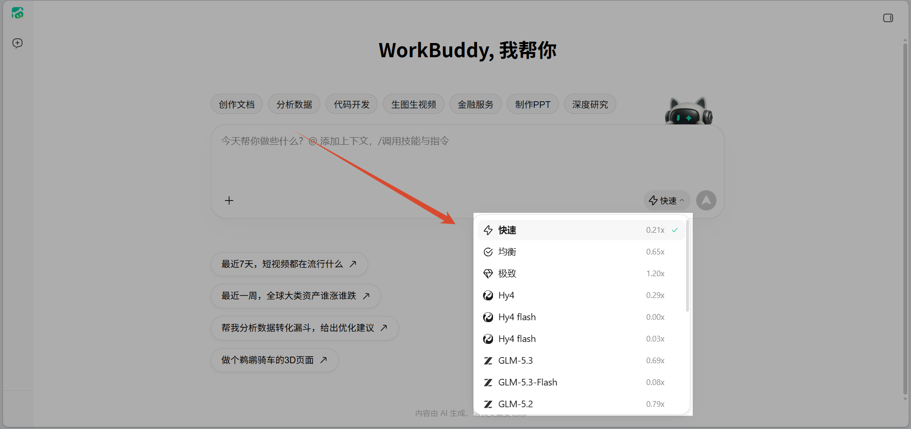

# 如何选择适合自己的 AI 模型？

> 这是一份面向入门用户的 AI 选型指南，希望帮助你从「会提问」进一步走向「会选择」。如果你已经是 AI 深度用户，本文对你的帮助可能有限。
>
> 注：本文所说的 AI，主要指基于大语言模型（LLM）的对话式 AI 产品，而非广泛意义上的人工智能。模型版本、规格和应用入口更新很快，涉及具体型号时，请以厂商最新的官方资料为准。

## 为什么需要选择模型？

无论是在 WorkBuddy、Qoder，还是其他类似的 AI 工具中，如果你仔细观察，都会发现一个「模型选择器」。这个模型选择器通常会提供很多选项，若你不清楚不同选项的区别，选择成本会很高。虽然软件通常会帮你配置一个默认模型，但默认选项只是为了兼顾通用性、响应速度和使用成本，并不一定适合当前的任务。

{ width="75%" }

或许你已经遇到过这种情况：一个任务交给 AI，它折腾了半天，最后还是没有做好。这未必是任务本身太难，也可能是模型的能力与任务要求不匹配。换一个更合适的模型，原本卡壳的工作可能就能顺利完成。

因此，我们有必要建立对模型的基本认知，以及学习如何选择一个模型。在继续之前，我们需要先了解几个基本概念。

## 模型、工具和 Agent

平时我们经常听到「模型」「工具」「Agent」这几个词，它们经常出现在同一个 AI 产品中，但实际上并不是同一回事。

不妨从一个具体任务入手。假设你想制作一份课件，向 AI 提出要求：「帮我生成一份关于某个主题的课件。」

这个过程中，通常需要几个部分配合完成：

- **模型（Model）**：负责理解你的要求、分析主题、构思大纲，并生成每一页的文字内容。

- **工具（Tools）**：负责执行具体操作，例如联网搜索、读取参考文件，或者将内容真正生成为 PPT 文件。

- **执行流程**：负责组织这些步骤，例如先制定计划，再搜索资料、生成课件，最后检查内容和格式，发现问题后继续修改。

可以将它们之间的关系简单理解为：

- 只有模型：能够根据已有输入理解要求、组织内容并生成回答。

- 模型与工具结合：能够读取外部资料、搜索信息，或者生成文件。

- 模型参与任务规划，并根据执行结果不断决定下一步行动：这就是 Agent（智能体）常见的工作方式。

这里需要特别注意：**Agent 并不是比推理模型更高级的「新一代模型」，而是一种系统形态。**

一个 Agent 实际能完成多少工作，既取决于底层模型的能力，也取决于软件提供了哪些工具、执行流程和权限。即使使用同一个模型，不同产品提供的 Agent 能力也可能相差很大。

## 模型之间究竟有什么区别？

如果你使用过多个 AI 服务，会发现模型的选择越来越多。除了不同厂商提供的模型，同一家厂商也可能提供多个系列、多个版本，甚至同一个型号下还有不同的模式。

为什么会出现这么多选择？一个重要原因是，模型的发展并不只是不断提高综合能力，还在向不同方向进行优化。

### 模型的发展经历了哪些变化？

如果回顾近几年的发展历程，会发现大语言模型的能力并不是一开始就如此丰富。从最初以文字对话为主，到后来逐渐具备多模态理解、复杂推理等能力，模型的发展实际上有着比较清晰的脉络。

下面选取几个具有代表性的时间节点：

| 时间    | 代表模型                    | 能力方向     | 说明                                                   |
| ------- | --------------------------- | ------------ | ------------------------------------------------------ |
| 2022.11 | ChatGPT（早期基于 GPT-3.5） | 自然语言对话 | 通过对话交代任务、追问和修改，成为大众接触 AI 的入口。 |
| 2024.05 | GPT-4o                      | 多模态       | 结合文本、视觉和音频能力，不再局限于纯文字交互。       |
| 2024.09 | OpenAI o1                   | 推理模型     | 面向需要多步推理的问题，在给出回答前投入更多思考。     |
| 2025.01 | DeepSeek-R1                 | 开放推理模型 | 通过开放模型与技术报告，让更多人得以接触推理能力。     |

可以发现，模型的发展并不只是沿着一条路线不断提高参数规模，而是逐渐向不同的能力方向扩展。

早期模型主要解决的是自然语言理解与生成问题，随后开始处理图片、音频等不同形式的信息。与此同时，针对复杂问题的推理能力也受到越来越多的关注，模型开始尝试投入更多计算资源进行多步分析。

需要注意的是，**这些能力并不是相互替代的关系，也不是每出现一种新模型，旧有能力就会消失。** 多模态、深度推理和工具调用，已经可以同时出现在同一个模型或产品中。不同厂商会根据自己的技术路线，将这些能力以不同方式组合起来。

如果想了解这些节点的背景，可以参考对应的官方发布资料：

- [ChatGPT 发布介绍](https://openai.com/index/chatgpt/)

- [GPT-4o 发布介绍](https://openai.com/index/hello-gpt-4o/)

- [OpenAI o1 发布介绍](https://openai.com/index/introducing-openai-o1-preview/)

- [DeepSeek-R1 发布介绍](https://api-docs.deepseek.com/news/news250120/)

### 当前主流模型的规格差异

了解了模型的发展脉络，再来看目前不同厂商提供的模型，就容易理解为什么会有这么多不同的型号和选择。

下面整理了截至 **2026 年 9 月 13 日** 的几款代表性模型规格，常见 AI 应用或聚合服务商通常会提供其中的部分模型：

| **模型**                             | **输入能力**          | **容量标称**     | **主要特点**                 |
| ------------------------------------ | --------------------- | ---------------- | ---------------------------- |
| DeepSeek V4.1-Flash                  | 文字、图片            | `1M` 上下文      | 速度快，支持思考与工具       |
| DeepSeek V4-Pro                      | 文字                  | `1M` 上下文      | 复杂文本任务、工具执行       |
| Qwen3.8-Flash                        | 文字、图片、视频      | `1M` 上下文      | 多模态、效率路线             |
| Qwen3.8-Max                          | 文字、图片、视频      | `1M` 上下文      | 复杂推理、长程任务           |
| Doubao-Seed-2.0（Pro / Lite / Mini） | 多模态（视版本而定）  | 按具体型号而定   | 同系列提供不同能力与成本档位 |
| Gemini 3.8 Flash                     | 文字、图片、视频、PDF | 约 `1M` 输入上限 | 多模态资料理解、长输入       |

**说明：**

1. 表中的 `1M` 约为一百万 Token，并不是一百万字。

2. Gemini 标注的是输入上限（仅计输入部分），其余标注的是上下文容量，通常包含输入与输出。

3. **容量相同不等于效果相同**，实际表现仍需结合输入能力、思考方式及真实输出结果综合判断。

因此，我们不能只看模型名称来判断它的能力。实际选择时，更应该关注下面几个方面。

### 多模态：模型能够理解什么？

所谓多模态（Multimodal），就是模型能够处理文字以外的多种信息形式。

常见的输入形式包括：

- **文字**：通知、参考资料、任务要求。

- **图片**：扫描版教材、截图、统计图表。

- **视频**：画面内容以及画面的时间顺序。

- **音频**：语音录音、课堂讲解。

举个常见的例子：你上传一份带有复杂表格的 PDF，让 AI 帮忙整理数据，结果它要么把行和列看串了，要么直接表示无法读取。

为什么会这样？很多时候，问题出在文件处理方式上。部分软件会先从 PDF 中提取文字，再将提取结果交给模型。如果原本的表格结构在提取过程中丢失，模型自然很难准确还原数据之间的关系。如果 PDF 本身是扫描件，那么它实际上是一张张图片，单纯处理文本的模型就无法直接理解其中的页面内容。此时，需要具备视觉理解能力的多模态模型，或者由软件先进行 OCR（光学字符识别）等处理。

因此，选择模型时，需要关注的不只是它能否处理文字，还要弄清楚：

> **它能接收什么？又能生成什么？**

注意，能够理解某种形式的输入，不代表就能生成同一种形式的内容。例如，很多模型能够理解图片，但最终只能输出文字，并不能直接生成图片。

另外，一些 AI 产品提供的语音对话功能，背后可能由语音识别、语言模型和语音合成等多个模型协作完成，并不是单一模型包揽所有工作。

### 上下文：模型一次能够处理多少信息？

使用 AI 时，我们经常会看到「上下文」（Context）这个词。它并没有想象中那么复杂，可以先把它理解成一本页数固定的笔记本。

每次与 AI 对话，你的任务要求、之前的聊天记录、上传的参考资料，以及模型即将生成的回答，都可能占用这本笔记本的空间。

假设这本笔记本一共只有 100 页：

- 上传的参考资料占了 35 页；

- 之前的聊天记录占了 15 页；

- 当前的任务要求和其他必要信息又占了 10 页。

那么，留给后续对话和回答的空间就已经不多了。

模型能够处理的上下文长度是有限的。当信息超出这个范围时，应用就需要对已有内容进行截断、压缩或其他处理，否则可能无法继续按照原来的上下文工作。

实际产品的处理方式各不相同，有些会自动压缩历史对话，有些会截断较早的内容，还有些会通过检索机制，只向模型提供当前任务相关的资料。

因此，选择模型时，需要关注上下文容量。不过，关于上下文，还有几个容易混淆的地方：

1. **上下文不等于永久记忆**：新开一个对话，通常就会产生一份新的上下文。有些产品能够跨对话记住用户的偏好，但那属于另一套记忆机制。

2. **文件大小不等于上下文长度**：上传文件后，软件不一定会将全文原封不动地交给模型，也可能先进行文本提取、检索或压缩。

3. **上下文越大不代表效果越好**：即使模型能够接收很长的材料，也不意味着它一定能准确利用其中的所有信息。内容过多时，仍然可能遗漏关键细节。

4. **上下文容量不等于输出长度**：模型单次能够生成多少内容，通常还有独立的输出上限。

另外，模型计量文本长度的单位是 Token，而不是字数。一个 Token 不固定等于一个汉字或一个英文单词，具体取决于分词方式。

所以，当你需要处理大量资料时，除了关注上下文容量，还应该考虑软件如何处理文件，以及模型能否有效利用这些信息。

### 思考模式：想得更久，就一定更好吗？

现在不少模型都提供了「思考模式」，有些还允许用户调整思考强度。与直接生成回答的模式相比，推理模型或思考模式通常会为复杂问题投入更多计算资源，尝试进行多步分析，再给出最终结果。

这在处理复杂任务时确实有帮助。例如，制定一个同时满足多个条件的方案，或者分析一段比较复杂的程序逻辑，都可能需要更多推理过程。但需要明确：**思考时间和结果可靠性并不等同。**

更多的计算资源有机会改善复杂问题的处理效果，但并不能保证最终答案一定正确。模型仍然可能误解问题、遗漏条件，甚至在推理过程中产生错误。

日常使用时，应根据任务特点进行选择：

- **简单改写、提取要点**：优先使用快速模式，没有必要为简单任务投入过多计算资源。

- **多条件分析、复杂规划**：可以尝试开启思考模式，或者选择推理能力更强的型号。

- **涉及重要事实、数字和引用**：无论使用哪种模式，都应该回到原始资料核对。

此外，模型本身的知识不会随着日期推移自动更新。即使开启联网搜索，也不代表搜索到的资料和最终结论一定准确。

### 工具调用：模型能够完成哪些实际操作？

前面已经介绍过模型和工具的关系。这里还需要进一步区分：模型本身支持工具调用，不代表它所在的应用就一定提供了对应工具。

例如，你希望 AI 帮你搜索最新资料：

- 模型需要具备理解任务、决定何时调用工具以及处理返回结果的能力。

- 应用需要提供联网搜索工具，并允许模型调用。

- 如果希望 AI 将搜索结果整理成文件，还需要对应的文件生成能力。

因此，面对需要实际操作的任务，不能只关注模型本身，还要检查应用提供了什么能力。

不过，现在很多面向办公场景的 AI 应用已经集成了常见工具。对于基本的办公操作，用户通常不需要自行配置底层工具；但具体能否完成，仍然取决于产品提供的功能和当前账号拥有的权限。

## 如何根据任务选择模型？

到这里，我们已经了解了模型之间几个重要的区别。那么，实际使用时应该如何选择？

其实不需要记住所有模型的技术参数。只要先弄清楚任务的要求，就可以逐步缩小选择范围。

| 任务特点               | 优先关注的能力             |
| ---------------------- | -------------------------- |
| 简单改写、提取要点     | 响应速度和基本文本能力     |
| 多条件分析、复杂规划   | 推理能力                   |
| 处理扫描件、图片和图表 | 视觉理解能力               |
| 综合多份长篇资料       | 上下文容量和文件检索能力   |
| 搜索最新资料           | 联网搜索工具和信息核验能力 |
| 生成 PPT、文档或表格   | 文件生成工具和实际执行能力 |

例如，你只是希望 AI 帮你润色一份通知，快速模型通常已经足够；如果你希望它综合多份材料，分析其中的矛盾并制定方案，就可以考虑使用推理能力更强的型号。

如果你需要它读取扫描版教材，那么首先应该确认模型或应用是否具备视觉处理能力，而不是单纯寻找一个综合排名更高的模型。

**选型的关键不是寻找一个适合所有任务的模型，而是找到能够满足当前任务要求的模型。**

### 如何了解主流模型？

目前比较常见的模型厂商包括 DeepSeek、通义千问（Qwen）、豆包（Doubao）和 Google Gemini 等。

不同厂商的模型命名方式和产品划分并不完全相同。有些会提供快速型与旗舰型，有些会提供不同规模的模型，还有些会将思考模式、多模态能力作为同一系列中的不同配置。

例如，DeepSeek、Qwen 等模型系列中，可能会出现 Flash、Pro、Max 之类的名称。但这些名称并不是行业统一的性能等级，也不能简单认为带有 Pro 或 Max 的型号在所有任务中都一定更好。

了解一个模型时，建议重点关注以下信息：

- **具体版本**：系列名称相同，不代表底层模型完全相同。

- **输入与输出能力**：是否支持图片、音频、视频，以及对应的生成能力。

- **上下文容量**：能够接收多少 Token，输入和输出是否采用相同的容量口径。

- **思考方式**：是否支持推理模式，以及不同模式之间的区别。

- **实际使用成本**：响应速度、调用价格、订阅额度等。

如果面对大量型号，不知道从哪里开始了解，可以借助第三方评测平台。例如，Artificial Analysis（AA）提供了模型榜单、模型对比和评测方法介绍，可以作为初步筛选模型的参考。

相关入口：

- [Artificial Analysis：模型榜单](https://artificialanalysis.ai/models)

- [Artificial Analysis：模型对比](https://artificialanalysis.ai/models/comparisons)

- [Artificial Analysis：评测方法](https://artificialanalysis.ai/methodology/intelligence-benchmarking)

使用榜单时需要注意：

1. **看具体版本**：不要只看厂商或模型系列名称。

2. **看评测内容**：综合排名往往汇总了多项测试，不同测试的侧重点也不一样。

3. **对照实际入口**：榜单中的模型能力，不一定与某个聊天产品开放的功能完全一致。

尤其需要注意：API 调用价格不等于聊天产品的订阅价格；模型在榜单上的表现，也不代表它已经通过了你的实际工作场景检验。

你可以根据榜单选择模型，然后根据自己的实际需求进行检验。

## 把任务要求说清楚

选择了合适的模型，并不意味着一定能够得到满意的结果。这里所说的提示词（Prompt），就是我们交给 AI 的任务说明。它不一定要很长，关键是把真正影响结果的信息交代清楚。

很多时候，AI 的表现不理想，并不是模型能力不足，而是任务要求本身不够明确。

例如，你只告诉 AI：「帮我做一节课。」

它实际上并不知道：

- 这节课是给谁上的？

- 听众具备什么基础？

- 需要讲解多长时间？

- 应该以哪些资料为依据？

- 最终需要文字稿，还是可以直接使用的课件？

在缺少这些信息的情况下，AI 只能根据自己的理解进行补充，结果自然可能与你的预期不一致。

一份比较完整的任务说明，至少应该交代四个方面：

- **用途**：这份内容最终用来做什么？

- **受众**：阅读或使用它的人有什么基础？

- **依据**：需要参考哪些资料，有没有必须遵守的要求？

- **完成标准**：篇幅、时间、格式和必须包含的内容有哪些？

例如，与其简单地说「帮我制作一份课件」，不如明确告诉 AI：

「请根据我上传的教材，为计算机专业的大二学生制作一份 30 分钟的课堂课件。内容以教材为准，重点解释其中的三个核心概念，并使用具体例子辅助理解。最终生成可以编辑的 PPT 文件。」

可以发现，后者并没有使用多么复杂的提示词，只是把真正影响结果的条件交代清楚了。

因此，**提示词并不是越长越好，关键是把那些会改变结果的信息补充完整。**

## 遇到问题时，先判断究竟卡在哪里

使用 AI 时，如果结果不理想，很多人的第一反应可能是「这个模型不行，换一个」。实际上，应该先判断问题出现在哪个环节。

常见的情况大致可以分为四种：

1. **答非所问**：模型没有正确理解你的要求，可能是任务描述不清楚，也可能是缺少必要的背景信息。

2. **遗漏资料**：模型没有获取到关键内容，可能是文件提取失败、上下文不足，或者检索没有找到相关资料。

3. **推理出错**：模型已经理解任务，但在分析过程中遗漏条件或得出了错误结论。此时可以尝试更强的推理模型，或者将复杂任务拆分。

4. **没有完成操作**：模型给出了操作建议，却没有真正执行。这通常需要检查应用是否提供对应工具，以及是否拥有必要权限。

定位清楚问题之后，再决定是修改要求、补充资料，还是更换模型或工具。

另外，AI 给出的回答可能非常流畅，逻辑看起来也很合理，但其中仍然可能存在事实错误。涉及重要事实、数字和引用时，应当回到原始资料核对；如果要求 AI 生成文件或执行操作，则需要确认文件确实生成、能够正常打开，并且符合预期。**模型回复「已完成」，并不代表任务已经真正完成。**

## 简单总结：四步工作法

下次准备使用 AI 处理任务时，可以按照下面四个步骤进行判断：

1. **分析任务**：输入是什么？需要多复杂的分析？最终需要什么形式的结果？

2. **选择模型与工具**：根据任务需要的能力，选择合适的模型和应用入口。

3. **明确要求**：交代用途、受众、参考资料和完成标准。

4. **检查结果**：核对事实是否正确，实际成果能否使用，还有多少工作需要自己完成。

归根结底，选择模型并不是为了追求某个榜单上的最高排名，也不是每次都要使用最昂贵的旗舰型号。

**真正值得关注的是：AI 能否可靠地完成当前任务，并且真正减少你的工作量。**

## 参考资料

- [ChatGPT：2022 年发布介绍](https://openai.com/index/chatgpt/)

- [GPT-4o：多模态能力介绍](https://openai.com/index/hello-gpt-4o/)

- [OpenAI o1：推理模型介绍](https://openai.com/index/introducing-openai-o1-preview/)

- [DeepSeek-R1：发布介绍](https://api-docs.deepseek.com/news/news250120/)

- [DeepSeek：模型更新记录](https://api-docs.deepseek.com/updates/)

- [DeepSeek：模型价格信息](https://api-docs.deepseek.com/quick_start/pricing/)

- [Qwen3.8-Flash：型号规格](https://help.aliyun.com/zh/model-studio/qwen3-8-flash)

- [Qwen3.8-Max：型号规格](https://help.aliyun.com/zh/model-studio/qwen3-8-max)

- [Doubao-Seed-2.0：官方介绍](https://developer.volcengine.com/articles/7610285824933445675)

- [Gemini 3.8 Flash：型号规格](https://ai.google.dev/gemini-api/docs/models/gemini-3.8-flash)

- [Artificial Analysis：模型榜单](https://artificialanalysis.ai/models)

- [Artificial Analysis：模型对比](https://artificialanalysis.ai/models/comparisons)

- [Artificial Analysis：评测方法](https://artificialanalysis.ai/methodology/intelligence-benchmarking)