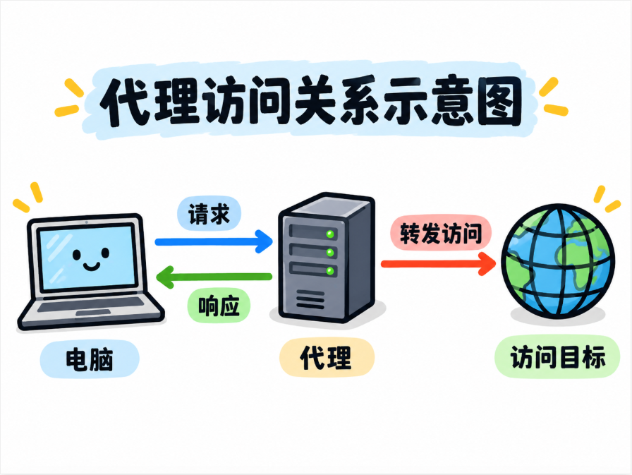
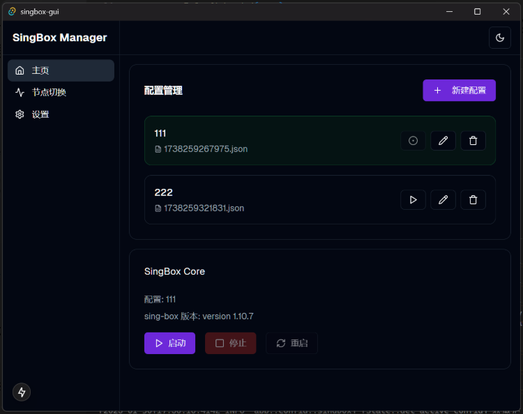
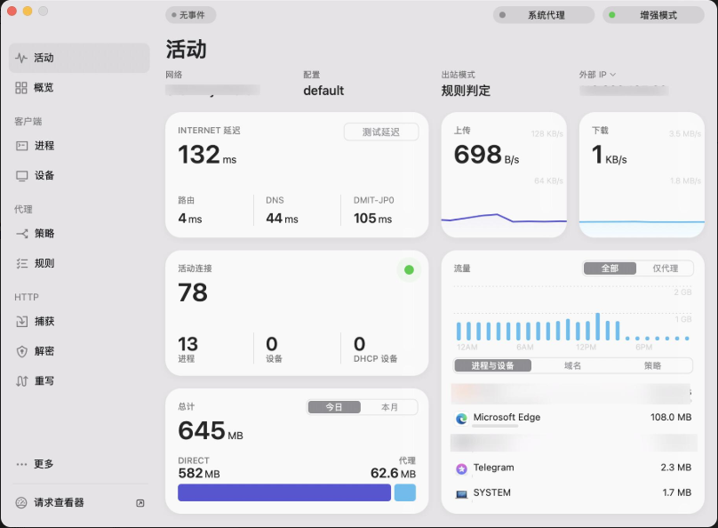
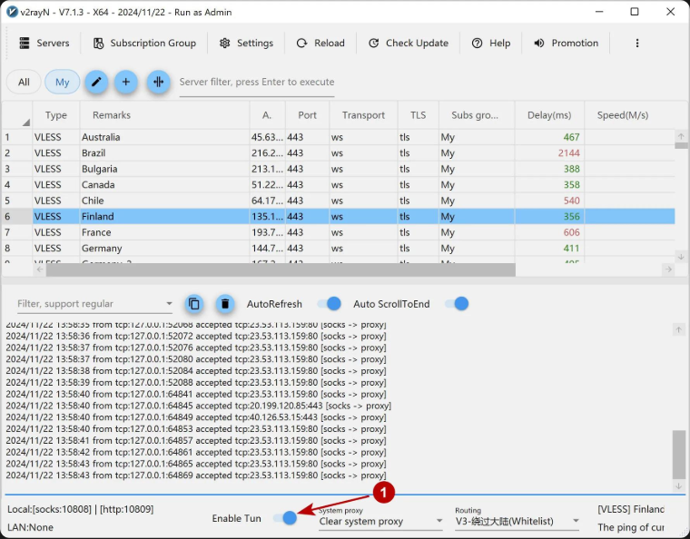
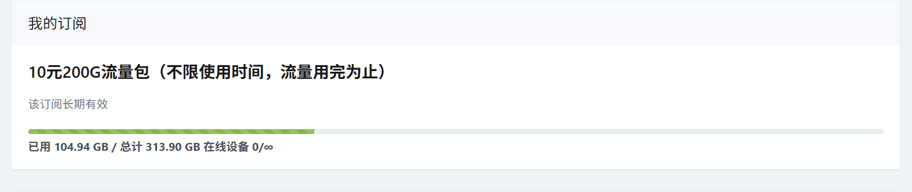
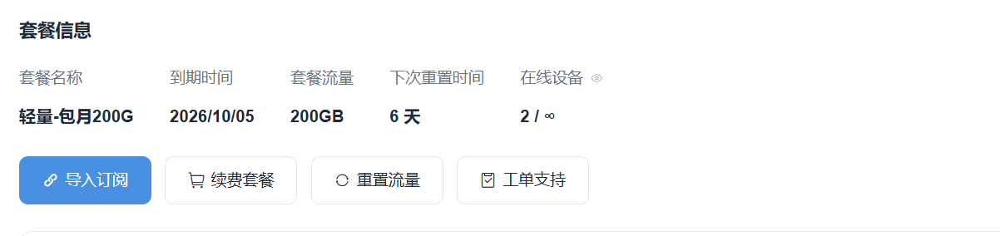
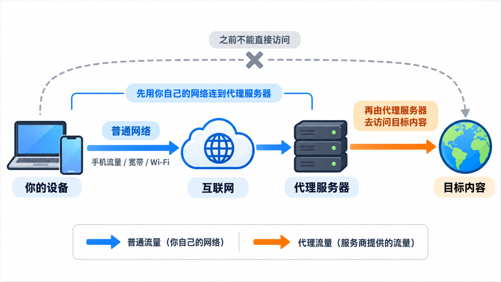

# 代理

> **声明：** 本文仅为技术学习笔记，用于理解网络代理的相关概念与原理。

## 什么是代理

类比生活中的场景：

- 你需要租房 ➡ 自己找房子麻烦 ➡ 找中介，中介替你找 ➡ 你只需要和中介沟通

  - 这里的中介就是**代理**

- 在校内想吃外卖 ➡ 不希望自己去店里拿 ➡ 点外卖，外卖骑手帮你送过来 ➡ 你只需要在指定位置获取外卖，而不需要自己跑一趟店铺！

  - 这里的外卖骑手也可以看作一种**代理**

对于网络访问，也是同样的道理。通常情况下，当你希望访问一个网站时，你的电脑会通过网络与目标服务器建立连接。而通过代理访问，则是：

> **你的电脑 ➡ 代理服务器 ➡ 目标网站**

这里，代理服务器就扮演了中介的角色。你将请求交给代理服务器，由它替你访问目标网站，再将结果转交给你。例如，你希望访问一个平时访问不到的网站，而代理服务器能够访问。于是，你可以将请求交给代理服务器，由它代替你完成访问。这就是网络代理的一种常见用途。

{ width="75%" }

> 很多人会将这类服务统称为 VPN，但事实上，VPN 和代理并不是同一个概念。两者可以实现一些相似的用途，但工作原理并不完全相同。这里暂时不深入讨论。

## 为什么需要代理

对于普通用户来说，一个很常见的原因，就是希望访问更多互联网资源。例如：

- Google
- DeepSeek
- 等等

这些资源对学习和提高工作效率有很大的帮助。不过，由于地区、网络环境、服务提供方等因素，我们未必能够直接访问所有互联网资源。

代理可以改变网络请求的访问路径，让请求经过另一台服务器转发，从而在一些情况下解决网络访问问题。当然，代理并不是万能的。一个网站无法访问，可能有很多原因；即使通过代理能够建立连接，也不代表该服务一定允许你使用。

## 什么是代理软件？

前面提到，我们可以通过代理服务器访问一些网络资源。那么，如何使用这些代理服务器呢？通常有一类软件，专门用于管理和使用代理。

这里需要注意：**代理软件和代理服务是两个不同的概念。**

- 代理软件：用于管理代理配置、选择节点、转发网络请求。
- 代理服务：实际提供代理服务器，负责转发你的网络请求。

就好比外卖软件和外卖骑手。外卖软件可以帮你下单、选择配送服务，但真正负责配送的还是骑手。只有软件，没有相应的配送服务，外卖也送不到你手上。

> - 外卖软件 ➡ 代理软件
>
> - 配送服务 ➡ 代理服务

因此，**安装了代理软件，并不意味着你已经拥有了代理服务。**

代理服务通常由服务商提供，也可以自行搭建。一些服务商会提供订阅链接，将其导入兼容的代理软件后，就能够获取相应的节点和配置信息。当然，不同代理软件支持的协议和配置格式可能不同，并不是所有订阅都能够通用。

## 常见的代理软件

### Clash Verge Rev

[Clash Verge Rev](https://github.com/clash-verge-rev/clash-verge-rev)，比较常见的代理客户端，使用 Mihomo 内核，功能相对完善。

{ width="75%" }

### Mihomo Party / Clash Party

[Clash Party](https://github.com/mihomo-party-org/clash-party)，界面比较漂亮，功能也比较丰富。

{ width="75%" }

### sing-box

[sing-box](https://sing-box.sagernet.org/)，严格来说，sing-box 本身主要是代理内核，并不等同于具有图形界面的客户端。不过，也有一些工具为它提供了图形化管理界面。

{ width="75%" }

### Surge

[Surge](https://nssurge.com/)，功能丰富，除了代理以外，还提供网络调试、流量分析等功能。

{ width="75%" }

### v2rayN

[v2rayN](https://github.com/2dust/v2rayN)，老牌软件，支持多种代理内核和协议，功能比较全面。

{ width="75%" }

## 如何使用代理？

### 代理软件选择

代理软件有很多，选择一个好的代理软件很有必要。对于普通用户而言，其实没有必要过度纠结。这里我只推荐一个：[FlClash](https://github.com/chen08209/FlClash)。

{ width="75%" }

它提供了相对简洁的界面，支持 Windows、Android 等多个平台，常用的代理功能也比较齐全。对于只是希望正常使用代理的用户来说，已经足够了。

当然，这只是个人推荐。如果你已经有了习惯使用的软件，而且运行正常，那么也没有必要特意更换。

### 选择代理节点

一个服务商通常会提供一系列的代理节点。这里的代理节点，可以简单理解为代理服务的一个入口。选择不同的节点，就是选择不同的服务器来转发网络请求。

不妨继续使用前面的外卖例子。当你点外卖时，会有许多骑手可以配送，不同骑手的配送速度、路线可能不同，代理节点也是一样的。

> 骑手 ➡ 代理节点

那么，**如何选择一个合适的代理节点呢？**

请先忽略服务商各种天花乱坠的宣传。对于普通用户来说，主要关注以下几个方面：

- **延迟**：网络请求需要多长时间才能得到响应，通常越低越好。
- **稳定性**：连接是否稳定，会不会使用一段时间后突然断开。
- **速度**：下载文件、观看视频时是否流畅。
- **地区**：节点所在的地区，可能影响一些服务能否正常使用。

其中，延迟是比较容易观察的指标，大多数代理软件都提供了延迟测试功能。但需要注意，**延迟低不等于速度快，更不意味着节点一定稳定。**

例如，一个节点显示延迟只有 `10ms`，可能是因为测试服务器离节点很近，也可能与测试方式有关。真正重要的还是实际使用体验。

对于普通用户，我的建议是：**优先选择稳定、速度满足需求、地区合适的节点。** 没有必要为了追求更低的延迟而反复切换。

### 代理软件常见模式

在选择好代理软件和代理节点后，就可以开始连接代理服务了。不过，为了让整个使用体验更好，你至少需要了解一些常见模式。

不同代理软件可能存在一些差异，但底层思路基本相同。我们可以从两个角度理解：

1. 电脑上的网络流量，如何交给代理软件？
2. 代理软件接管流量后，又应该如何处理？

**第一个角度**，常见的方式包括：

- 系统代理
- TUN 模式

**系统代理**，即通过系统提供的代理设置，让支持并使用这一设置的软件，将网络请求交给代理软件处理。例如，浏览器通常可以使用系统代理，因此开启系统代理后，浏览器的网络请求就可能经过代理软件。但一些客户端软件未必会使用系统代理，它们可能仍然选择直接连接目标服务器。

为了解决这类问题，就可以考虑 **TUN 模式**。它会创建一个虚拟网卡，通过系统网络路由，将相应的流量交给代理软件处理。

简单理解：

> **系统代理**：应用需要支持并使用代理设置。
>
> **TUN 模式**：通过虚拟网卡，让更多应用的流量进入代理软件，而不要求这些应用自己支持系统代理。

需要注意，TUN 模式并不意味着电脑的所有流量都会被接管，实际范围仍然取决于系统路由和软件配置。

**第二个角度**：当代理软件接管了流量后，应该如何处理？

以 Clash / Mihomo 类软件为例，常见的模式有：

- **直连模式**：直接访问目标服务器，不使用远端代理节点。
- **规则模式**：根据预先设定的规则，决定哪些请求需要经过代理节点，哪些请求直接访问。
- **全局模式**：将接管的流量统一交给选定的代理节点或策略处理，而不再按照普通分流规则决定是否直连。

这两类设置分别决定了流量如何进入代理软件，以及进入后如何处理，因此实际上是可以组合的。例如：

- 系统代理
    - 规则模式
    - 全局模式
- TUN 模式
    - 规则模式
    - 全局模式

> **全局模式和 TUN 模式有什么区别？**
>
> 它们其实是从不同的角度划分的。TUN 模式负责让流量进入代理软件，全局模式负责决定流量进入代理软件后如何处理。
>
> 例如，开启 TUN + 规则模式后，网络请求可能经过以下过程：
>
> 应用 ➡ TUN 虚拟网卡 ➡ 代理软件 ➡ 匹配规则 ➡ 直连或者代理
>
> 因此，**经过代理软件，并不意味着一定会经过远端代理服务器。** 反过来，如果应用的流量根本没有进入代理软件，即使开启了全局模式，也不会自动接管这些流量。

## 注意

### 小心服务商！

前面提到，代理服务通常由服务商提供，而服务商可能需要收取一定的费用。这里需要注意一个问题：**你的网络请求需要经过代理服务器，因此服务商是否可信非常重要。**

不过，这并不意味着代理服务商能够看到你访问的所有内容。现代互联网通常使用 HTTPS 进行加密传输。正常情况下，即使网络请求经过代理服务器，服务商也无法直接读取 HTTPS 连接中传输的密码、消息等具体内容。

继续用外卖来举例。外卖骑手知道你从哪里购买了外卖、配送到了哪里，但如果外卖包装完好，骑手并不知道里面具体装了什么。对于代理服务商来说，也是类似的道理。

通常情况下，服务商可能知道：

- 你何时建立连接。
- 你连接的目标地址或相关信息。
- 连接产生了多少网络流量。

但是，对于正常加密的 HTTPS 内容，服务商通常无法直接读取。

> 这里讨论的是代理正常转发加密连接的情况。如果设备安装并信任了某些用于 HTTPS 解密的证书，情况可能有所不同。

因此，日常使用代理时，不必认为所有个人信息都会直接暴露，但也不能认为使用了 HTTPS 就绝对安全。**选择可信的服务商，仍然是十分重要的。**

尤其需要警惕：

- 来历不明的代理软件。
- 缺少基本说明、售后和联系方式的服务商。
- 价格异常低廉，却做出大量不切实际承诺的服务。
- 要求安装不明证书、关闭系统安全防护的操作。

如果浏览器或安全软件提示存在风险，应先弄清楚原因，而不是直接忽略。另外，代理服务的提供和使用可能受到所在地法律法规、网络管理规定以及目标平台使用条款的约束，使用时也需要注意这一点。

### 此流量不等于彼流量

购买代理服务时，你经常会看到一个名词：**流量**。例如：

{ width="75%" }

{ width="75%" }

这些套餐可能按月提供一定的流量，也可能提供不限时间的流量包，虽然表现形式各不相同，但本质上都是代理服务商提供的使用额度。

这里需要注意：**此流量非彼流量。** 代理服务商提供的流量，并不能代替你在运营商那里购买的流量套餐，也不能代替宽带。为什么？因为代理本身不会凭空提供网络连接。你必须先连接互联网，才能通过网络访问代理服务器。

不妨做个实验：关闭手机的移动数据和 Wi-Fi，然后打开代理软件，尝试访问百度、淘宝等网站。你会发现，即使代理软件处于开启状态，也无法正常访问互联网，因为连接代理服务器本身就需要网络。

它们的区别如下：

{ width="75%" }

简单总结：

- **普通流量**：运营商提供的网络套餐，在使用移动网络时消耗。
- **代理流量**：代理服务商提供的使用额度，在使用相应代理服务时消耗。

例如，你使用手机移动数据，通过代理下载了一个文件，那么这次下载可能同时消耗运营商的移动数据和代理服务商提供的流量额度。

**代理流量不是额外赠送给你的手机流量，而是代理服务本身的使用额度。**

### 尽量稳定 IP 地区

每一个代理节点通常都有对应的出口 IP，而这些 IP 又可以根据所属地区进行划分。因此，我们经常可以看到许多地区：

- 新加坡
- 美国
- 英国
- 等等

为什么需要关注地区？因为通过代理访问网站时，目标网站通常看到的是代理服务器的出口 IP，而不是你原本的公网 IP。

一些互联网服务会根据访问地区提供不同的功能，或者限制部分地区的使用。因此，节点能够连接，并不意味着所有服务都能够正常使用。在选择地区时，应该结合目标服务实际支持的地区，以及相关使用要求进行判断。

另外，我个人建议：**如果已经找到了一个稳定、适合日常使用的地区，就没有必要频繁更换。**

你当然可以切换节点，但如果只是为了改善连接速度，可以先尝试同一地区的其他节点。一些平台会将登录地区、设备和网络环境作为账户安全判断的参考，短时间内频繁出现不同地区的登录记录，有时可能触发额外验证。保持一个稳定的区域，一定程度上能够获得稳定的服务。
